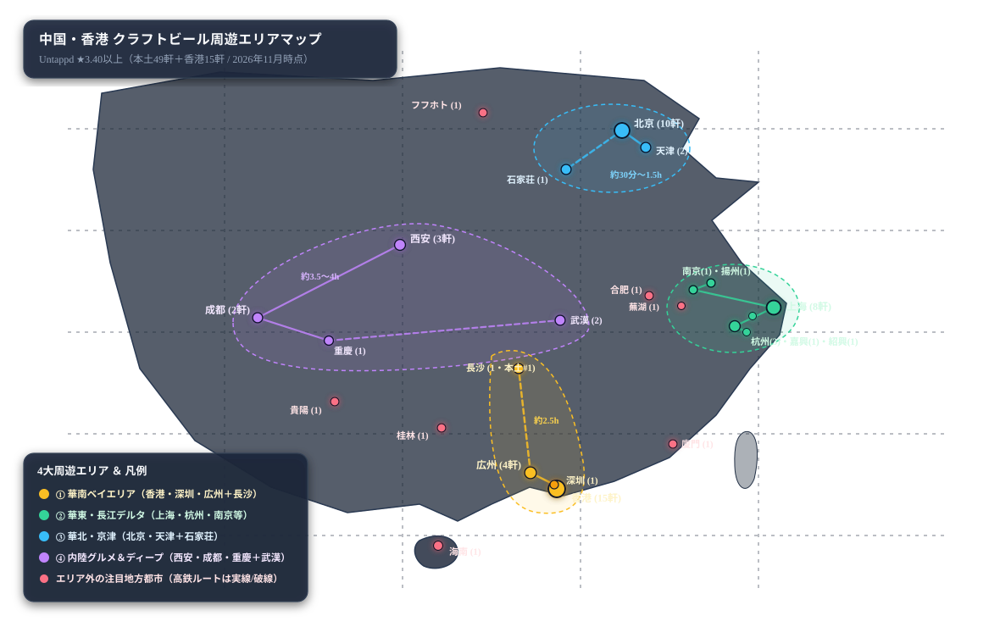

中国本土と香港のクラフトビールシーンは、この数年で劇的な進化を遂げています。かつては北京や上海の外国人街を中心としたパブ文化が主流でしたが、現在は**中国全土の地方都市から世界基準の Hazy IPA やサワー、中国茶・スパイスを巧みに使ったローカルクラフトが次々と生まれる群雄割拠の時代**に入っています。

本記事では、**2026年11月19日時点の Untappd ランキングデータ**から公平に比較するため **平均評価 ★3.40 以上** に基準を統一した **計64軒（中国本土 49軒 ＋ 香港 15軒）** をもとに、旅行者が高鉄（高速鉄道）で効率よく巡れる**「4つの周遊エリア」**に整理して徹底解説します。

<a href="#overview" class="quick-jump-pill inline-flex items-center px-3 py-1.5 rounded-lg text-xs sm:text-sm font-semibold bg-slate-100 hover:bg-blue-50 text-slate-800 hover:text-blue-700 border border-slate-200 hover:border-blue-300 transition-all shadow-2xs">📊 全体像・マップ</a>
<a href="#area-1" class="quick-jump-pill inline-flex items-center px-3 py-1.5 rounded-lg text-xs sm:text-sm font-semibold bg-amber-50 hover:bg-amber-100 text-amber-900 border border-amber-200 hover:border-amber-300 transition-all shadow-2xs">① 華南ベイエリア（香港・広州・長沙）</a>
<a href="#area-2" class="quick-jump-pill inline-flex items-center px-3 py-1.5 rounded-lg text-xs sm:text-sm font-semibold bg-emerald-50 hover:bg-emerald-100 text-emerald-900 border border-emerald-200 hover:border-emerald-300 transition-all shadow-2xs">② 華東・長江デルタ（上海・杭州・南京）</a>
<a href="#area-3" class="quick-jump-pill inline-flex items-center px-3 py-1.5 rounded-lg text-xs sm:text-sm font-semibold bg-sky-50 hover:bg-sky-100 text-sky-900 border border-sky-200 hover:border-sky-300 transition-all shadow-2xs">③ 華北・京津（北京・天津・石家荘）</a>
<a href="#area-4" class="quick-jump-pill inline-flex items-center px-3 py-1.5 rounded-lg text-xs sm:text-sm font-semibold bg-purple-50 hover:bg-purple-100 text-purple-900 border border-purple-200 hover:border-purple-300 transition-all shadow-2xs">④ 内陸グルメ（西安・成都・重慶・武漢）</a>
<a href="#regional-column" class="quick-jump-pill inline-flex items-center px-3 py-1.5 rounded-lg text-xs sm:text-sm font-semibold bg-rose-50 hover:bg-rose-100 text-rose-900 border border-rose-200 hover:border-rose-300 transition-all shadow-2xs">🌏 地方注目ブルワリー</a>
<a href="#travel-tips" class="quick-jump-pill inline-flex items-center px-3 py-1.5 rounded-lg text-xs sm:text-sm font-semibold bg-slate-100 hover:bg-blue-50 text-slate-800 hover:text-blue-700 border border-slate-200 hover:border-blue-300 transition-all shadow-2xs">🚆 旅行者向けTips</a>
<a href="#appendix-data" class="quick-jump-pill inline-flex items-center px-3 py-1.5 rounded-lg text-xs sm:text-sm font-semibold bg-slate-100 hover:bg-blue-50 text-slate-800 hover:text-blue-700 border border-slate-200 hover:border-blue-300 transition-all shadow-2xs">📋 全64軒データ表</a>

> **💡 この記事の操作ヒント**: 表のヘッダー（`Untappd`・`ビール数`・`評価数` など）をクリックすると昇順・降順で並び替えられます。ブルワリー名をクリックすると Untappd ページへ移動します。

---

## 1. 全体像：データで見る中国・香港のクラフトビール

Untappd 平均評価 **★3.40 以上** に揃えた中国本土 49軒と香港 15軒（計64軒）を俯瞰すると、大きく **3つのトレンド** が浮かび上がります。

1. **香港・北京・上海の3大都市で過半数、しかしトップ層は「地方都市」が席巻**
   - 軒数ベースでは香港（15軒）・北京（10軒）・上海（8軒）の3都市で全体の **51.6%（33/64軒）** を占めます。
   - 一方で、本土ランキング **Top 10 のうち7軒は北京・上海以外の都市**（長沙 #1、広州 #2/#3、西安 #4、揚州 #5、石家荘 #6、合肥 #8、海南 #10）。近年は地方の気鋭ブルワリーが圧倒的な高評価を獲得しています。
2. **Nano Brewery（極小規模醸造所）の躍進**
   - 本土 49軒のうち **11軒が Nano Brewery** に分類され、しかも #1 混沌酿造（長沙 / ★4.123）、#4 Fever Ales（西安 / ★3.934）、#6 YE Brewing（石家荘 / ★3.867）と超上位に食い込んでいます。直営タップルームを持たず委託醸造や都市部のセレクトビアバーへ樽・缶を卸すスタイルも多く、飲み歩きには事前の情報収集が鍵になります。
3. **「老舗パイオニア（評価数1万超）」と「新世代ハイスコア勢」の二極化**
   - 北京の **Jing A（27,338件）**、**Great Leap（25,109件）**、**Slowboat（14,588件）**、上海の **Boxing Cat（27,612件）**、香港の **Gweilo（84,936件）**・**Young Master（58,314件）** は圧倒的な知名度と店舗網を持つ王道です。
   - 対して平均評価 **3.8〜4.1超** の新世代は、濃厚な Hazy IPA やフルーツ／ペイストリーサワー、洗練されたラガーなどを小ロットで仕込むギーク向けブルワリーが中心です。

---

## 2. エリア①【華南ベイエリア】香港 ⇄ 深圳 ⇄ 広州（＋長沙）

### エリア特徴と移動目安
* **収録数**: 香港 15軒 ＋ 広州 4軒 ＋ 深圳 1軒（＋延泊で長沙 1軒）
* **高鉄移動の目安**:
  * 香港（西九龍） ⇄ 深圳（福田／深圳北）: **約15〜20分**
  * 深圳 ⇄ 広州（広州南／広州東）: **約30〜40分**
  * 広州 ⇄ 長沙（長沙南）: **約2.5時間**
* **エリアの個性**: 日本からのアクセスが最も良く、週末＋1〜2日でも回れるゴールデンルート。英語と広東語が通じやすくビアバー文化が成熟した**香港**と、近年中国本土で最もホットなハイスコア・ブルワリー（#2 Dr. Lab、#3 Crazy Bear）が密集する**広州・海珠区**を一度に楽しめます。さらに足を伸ばせば、本土ランキング1位の**長沙「混沌酿造」**まで射程圏内です。

### 注目ブルワリーピックアップ

### 1. 混沌酿造 (Chaosbrewing) — 本土 #1（長沙市）

📍 湖南省長沙市 / Nano Brewery
<a href="https://untappd.com/ChangShaChaobrewing" target="_blank" rel="noopener noreferrer" class="action-btn inline-flex items-center gap-1.5 px-3 py-1.5 rounded-lg text-xs sm:text-sm font-bold bg-amber-500 hover:bg-amber-600 text-white shadow-2xs transition-colors">🍺 Untappd</a>

* **Untappd ブルワリー評価**: **4.123**（登録ビール数: 105種 / 評価数: 1,120件）
* **特徴・スタイル**: 中国本土ランキング堂々の第1位（唯一の4.1点台）。ジューシーでアロマティックな Hazy IPA、Double / Triple IPA などホップフォワードなビールで熱狂的なファン（Chaoser）に支持される長沙の雄。
* **現地アクセス**: 長沙市内に直営タップルーム（五一広場店・黄土嶺店）を展開。特に繁華街の五一広場エリアは観光や激辛の湖南料理（湘菜）と合わせて訪れやすい立地です。

### 2. Dr. Lab / Crazy Bear Industry (疯熊工業) — 本土 #2・#3（広州市）

📍 広東省広州市（海珠区） / Micro Brewery

<a href="https://untappd.com/w/dr-lab/522484" target="_blank" rel="noopener noreferrer" class="action-btn inline-flex items-center gap-1.5 px-3 py-1.5 rounded-lg text-xs sm:text-sm font-bold bg-amber-500 hover:bg-amber-600 text-white shadow-2xs transition-colors">🍺 Dr. Lab</a>
<a href="https://untappd.com/CBIB" target="_blank" rel="noopener noreferrer" class="action-btn inline-flex items-center gap-1.5 px-3 py-1.5 rounded-lg text-xs sm:text-sm font-bold bg-amber-500 hover:bg-amber-600 text-white shadow-2xs transition-colors">🍺 Crazy Bear</a>

* **Untappd ブルワリー評価**:
  * **Dr. Lab**: **4.047**（178種 / 1,562件）
  * **Crazy Bear Industry**: **3.937**（171種 / 5,913件）
* **特徴・スタイル**: 広州クラフトシーンを牽引するトップ2。**Dr. Lab** は実験室を思わせる隠れ家的な空間で、独創的なフルーツ・ハーブ系ビールやハウスサイダー、ハイレベルな限定タップを提供。**Crazy Bear** は2018年に広州・海珠区のマンゴーの木の下で産声を上げ、現在は東莞に醸造設備を持ちつつ海珠区の「Crazy Bear Lab（怡安路152号）」を拠点に IPA やスタウトを幅広く展開しています。
* **回り方**: 両者のタップルームはともに**広州市海珠区**の近接エリアにあり、1晩でハシゴできるのが最大の魅力です。

### 3. Yardley Brothers / Carbon Brews / Young Master (少爺啤) — 香港トップ勢

📍 香港（香港島・新界・九龍） / Micro Brewery

<a href="https://untappd.com/YardleyBrothers" target="_blank" rel="noopener noreferrer" class="action-btn inline-flex items-center gap-1.5 px-3 py-1.5 rounded-lg text-xs sm:text-sm font-bold bg-amber-500 hover:bg-amber-600 text-white shadow-2xs transition-colors">🍺 Yardley</a>
<a href="https://untappd.com/CarbonBrews" target="_blank" rel="noopener noreferrer" class="action-btn inline-flex items-center gap-1.5 px-3 py-1.5 rounded-lg text-xs sm:text-sm font-bold bg-amber-500 hover:bg-amber-600 text-white shadow-2xs transition-colors">🍺 Carbon</a>
<a href="https://untappd.com/YoungMasterAles" target="_blank" rel="noopener noreferrer" class="action-btn inline-flex items-center gap-1.5 px-3 py-1.5 rounded-lg text-xs sm:text-sm font-bold bg-amber-500 hover:bg-amber-600 text-white shadow-2xs transition-colors">🍺 Young Master</a>

* **Untappd ブルワリー評価**:
  * **Yardley Brothers（香港 #1）**: **3.748**（221種 / 17,404件）
  * **Carbon Brews（香港 #2）**: **3.688**（164種 / 17,124件）
  * **Young Master Brewery 少爺啤（香港 #5）**: **3.639**（325種 / 58,314件）
* **特徴・アクセス**:
  * **Yardley Brothers**: 南丫島（ラマ島）のホームブルー発祥。強烈なインペリアルIPA（*Hong Kong Bastard*）からバレルエイジド・ワイルドエールまで攻めた銘柄が多く、中環（Soho）の *Yardleys Taproom* やラマ島の *The Beer Shack* で飲めます。
  * **Carbon Brews**: 新界・火炭（Fo Tan）発。洗練されたデザイン缶とモダンな Hazy IPA・サワーに定評があり、香港内の主要ビアバー・ボトルショップで広く流通しています。
  * **Young Master 少爺啤**: 2013年創業の香港クラフト界の重鎮。塩漬けライムを使った *Cha Chaan Teng Gose*（茶餐廳ゴーゼ）など香港らしいローカル素材の名作を多数生み出しています。中環（Central）の *BaseHall 01* 内にあるフラッグシップタップルームはアクセス抜群です。

### エリア① ブルワリー一覧（本土 Top 50 該当分＋香港上位抜粋）

| 区分・順位 | ブルワリー名 | 都市・エリア | タイプ | Untappd | ビール数 | 評価数 |
|---:|---|---|---|---:|---:|---:|
| 本土 #1 | [混沌酿造 (Chaosbrewing)](https://untappd.com/ChangShaChaobrewing) | 長沙市 (湖南省) | Nano Brewery | 4.123 | 105 | 1,120 |
| 本土 #2 | [Dr. Lab](https://untappd.com/w/dr-lab/522484) | 広州市 (広東省) | Micro Brewery | 4.047 | 178 | 1,562 |
| 本土 #3 | [Crazy Bear Industry (疯熊工業)](https://untappd.com/CBIB) | 広州市 (広東省) | Micro Brewery | 3.937 | 171 | 5,913 |
| 本土 #30 | [E.T. Brewery](https://untappd.com/w/e-t-brewery/316168) | 深圳市 (広東省) | Brew Pub | 3.572 | 175 | 2,572 |
| 本土 #33 | [The Strand Brewery And Cafe](https://untappd.com/TheStrandBrewery) | 広州市 (広東省) | Micro Brewery | 3.555 | 82 | 1,150 |
| 本土 #42 | [Bravo Brewing Co. (保霖精酿)](https://untappd.com/w/bravo-brewing-co-a-e-c2-e/290538) | 広州市 (広東省) | Brew Pub | 3.479 | 132 | 2,907 |
| 香港 #1 | [Yardley Brothers](https://untappd.com/YardleyBrothers) | 新界 (Lamma / Soho) | Micro Brewery | 3.748 | 221 | 17,404 |
| 香港 #2 | [Carbon Brews](https://untappd.com/CarbonBrews) | 新界 (Fo Tan) | Micro Brewery | 3.688 | 164 | 17,124 |
| 香港 #3 | [Richkat Craft Brewing 貓員外精釀啤酒](https://untappd.com/Rich_Kat_) | 香港島 | Brew Pub | 3.656 | 47 | 3,768 |
| 香港 #4 | [Heroes Beer Co.](https://untappd.com/HeroesBeerCo) | 香港島 | Micro Brewery | 3.641 | 122 | 15,699 |
| 香港 #5 | [Young Master Brewery 少爺啤](https://untappd.com/YoungMasterAles) | 香港島 | Micro Brewery | 3.639 | 325 | 58,314 |
| 香港 #6 | [Hong Kong Beer Co.](https://untappd.com/HKBeerCo) | 九龍 | Micro Brewery | 3.601 | 146 | 22,293 |
| 香港 #7 | [Deadman Brewery](https://untappd.com/DeadmanBreweryHK) | 九龍 | Nano Brewery | 3.595 | 100 | 4,674 |
| 香港 #8 | [Gweilo Beer](https://untappd.com/Gweilo_Beer) | 香港島 | Micro Brewery | 3.553 | 106 | 84,936 |

---

## 3. エリア②【華東・長江デルタ】上海 ⇄ 杭州（＋嘉興・紹興・揚州・南京）

### エリア特徴と移動目安
* **収録数**: 上海 8軒 ＋ 浙江 5軒（杭州 3・嘉興 1・紹興 1）＋ 江蘇 2軒（揚州 1・南京 1）＝ **計15軒**
* **高鉄移動の目安**:
  * 上海（虹橋） ⇄ 杭州（杭州東）: **約45分〜1時間**（嘉興は途中駅で約30分、紹興は杭州から約20分）
  * 上海 ⇄ 南京（南京南）: **約1〜1.5時間**（揚州は南京から約50分）
* **エリアの個性**: 高鉄網が最も密に発達しており、上海を拠点に**日帰り感覚で江蘇・浙江の実力派ブルワリーを網羅**できます。上海は *Liquid Laundry* や *Boxing Cat* などの洗練された大型ブルーパブと *Mingri* のような気鋭ローカルが共存し、周辺の杭州・揚州・南京には Untappd **3.7〜3.9点台**のホップ／サワー特化型マイクロがひしめいています。

### 注目ブルワリーピックアップ

### 1. SUIWU BREWING (虽吾酿造) — 本土 #5（揚州市）

📍 江蘇省揚州市 / Micro Brewery
<a href="https://untappd.com/Suiwu_jennifer" target="_blank" rel="noopener noreferrer" class="action-btn inline-flex items-center gap-1.5 px-3 py-1.5 rounded-lg text-xs sm:text-sm font-bold bg-amber-500 hover:bg-amber-600 text-white shadow-2xs transition-colors">🍺 Untappd</a>

* **Untappd ブルワリー評価**: **3.907**（53種 / 1,539件）
* **特徴・スタイル**: 華東エリア最高位（本土 #5）。登録銘柄数こそ53種と絞られていますが、1本1本の完成度が非常に高く、ホップの個性を引き出した Triple IPA（*Nelson Harvest / 尼尔森采收- 晚采* など）から端正なチェコピルスナー（*小金狼*）まで高い評価を得ています。

### 2. Hop Fan (或不凡) / Paper Plane Brewing (紙飛機釀造) — 本土 #15・#19（杭州市）

📍 浙江省杭州市 / Micro Brewery

<a href="https://untappd.com/w/hop-fan/385711" target="_blank" rel="noopener noreferrer" class="action-btn inline-flex items-center gap-1.5 px-3 py-1.5 rounded-lg text-xs sm:text-sm font-bold bg-amber-500 hover:bg-amber-600 text-white shadow-2xs transition-colors">🍺 Hop Fan</a>
<a href="https://untappd.com/Paper_Plane_Brewing" target="_blank" rel="noopener noreferrer" class="action-btn inline-flex items-center gap-1.5 px-3 py-1.5 rounded-lg text-xs sm:text-sm font-bold bg-amber-500 hover:bg-amber-600 text-white shadow-2xs transition-colors">🍺 Paper Plane</a>

* **Untappd ブルワリー評価**:
  * **Hop Fan (或不凡)**: **3.747**（86種 / 5,201件）
  * **Paper Plane Brewing (紙飛機釀造)**: **3.730**（134種 / 3,296件）
* **特徴・スタイル**: 西湖観光とセットで訪れたい杭州の2大巨頭。**Hop Fan** は漢詩をモチーフにしたシリーズ（*君不见*、*黄河之水* 等）とジューシーな Hazy IPA で全国的な知名度を誇ります。**Paper Plane** は2018年創業、ホップフォワードな IPA に加えてトロピカルで濃厚なフルーツクリームサワー（*酸声道* シリーズなど）で人気を博しています。

### 3. Mingri Brewing (明日酿造) / Liquid Laundry — 本土 #24・#38（上海市）

📍 上海市 / Micro Brewery・Brew Pub

<a href="https://untappd.com/MingriBrewing" target="_blank" rel="noopener noreferrer" class="action-btn inline-flex items-center gap-1.5 px-3 py-1.5 rounded-lg text-xs sm:text-sm font-bold bg-amber-500 hover:bg-amber-600 text-white shadow-2xs transition-colors">🍺 Mingri</a>
<a href="https://untappd.com/LiquidLaundry" target="_blank" rel="noopener noreferrer" class="action-btn inline-flex items-center gap-1.5 px-3 py-1.5 rounded-lg text-xs sm:text-sm font-bold bg-amber-500 hover:bg-amber-600 text-white shadow-2xs transition-colors">🍺 Liquid Laundry</a>

* **Untappd ブルワリー評価**:
  * **Mingri Brewing (明日酿造)**: **3.644**（299種 / 6,150件）
  * **Liquid Laundry**: **3.519**（119種 / 3,146件）
* **特徴・アクセス**: **Mingri Brewing** はホームブルー出身の名ブルワー Jin Fan 氏率いる上海ローカルの筆頭格。蘇州河沿い（黄浦区新閘路356号）にフラッグシップタップルームを構え、看板の *Hazy Dream NEIPA* やフルーツゴーゼなど299種もの多彩なビールをリリース。**Liquid Laundry** は淮海中路の大箱ガストロパブで、ガラス張りの醸造設備と本格窯焼きピザ＆クラフトビールのペアリングが楽しめます。

### エリア② ブルワリー一覧（全15軒）

| 順位 | ブルワリー名 | 都市・地域 | タイプ | Untappd | ビール数 | 評価数 |
|---:|---|---|---|---:|---:|---:|
| #5 | [SUIWU BREWING (虽吾酿造)](https://untappd.com/Suiwu_jennifer) | 揚州市 (江蘇省) | Micro Brewery | 3.907 | 53 | 1,539 |
| #14 | [Injoy (制乐厂)](https://untappd.com/w/injoy/542129) | 南京市 (江蘇省) | Micro Brewery | 3.751 | 73 | 1,279 |
| #15 | [Hop Fan (或不凡)](https://untappd.com/w/hop-fan/385711) | 杭州市 (浙江省) | Micro Brewery | 3.747 | 86 | 5,201 |
| #16 | [Bubble Lab Brewery (气泡实验室)](https://untappd.com/BubbleLab) | 嘉興市 (浙江省) | Micro Brewery | 3.745 | 97 | 4,340 |
| #19 | [Paper Plane Brewing 紙飛機釀造](https://untappd.com/Paper_Plane_Brewing) | 杭州市 (浙江省) | Micro Brewery | 3.730 | 134 | 3,296 |
| #24 | [Mingri Brewing (明日酿造)](https://untappd.com/MingriBrewing) | 上海市 | Micro Brewery | 3.644 | 299 | 6,150 |
| #35 | [Sheng Craft Beer (山乘酿造)](https://untappd.com/w/sheng-craft-beer/502580) | 紹興市 (浙江省) | Nano Brewery | 3.544 | 190 | 3,383 |
| #37 | [Dream Brewing (梦想酿造)](https://untappd.com/DreamBrew) | 上海市 | Micro Brewery | 3.531 | 157 | 4,055 |
| #38 | [Liquid Laundry](https://untappd.com/LiquidLaundry) | 上海市 | Brew Pub | 3.519 | 119 | 3,146 |
| #39 | [Mad Dragon - Shanghai](https://untappd.com/w/mad-dragon-shanghai/367281) | 上海市 | Brew Pub | 3.507 | 7 | 1,234 |
| #43 | [Goose Island Shanghai](https://untappd.com/w/goose-island-shanghai/330405) | 上海市 | Brew Pub | 3.451 | 146 | 6,359 |
| #45 | [Boxing Cat Brewery (拳击猫)](https://untappd.com/boxingcatbrewery) | 上海市 | Macro Brewery | 3.422 | 224 | 27,612 |
| #46 | [Postwave 厚浪](https://untappd.com/w/postwave/476397) | 上海市 | Micro Brewery | 3.411 | 44 | 1,245 |
| #48 | [申爱 Shanghai Love](https://untappd.com/w/shanghai-love/287560) | 上海市 | Micro Brewery | 3.406 | 25 | 1,326 |
| #49 | [Taste Room (忒斯特)](https://untappd.com/w/taste-room/333875) | 杭州市 (浙江省) | Nano Brewery | 3.404 | 86 | 1,908 |

---

## 4. エリア③【華北・京津】北京 ⇄ 天津（＋石家荘）

### エリア特徴と移動目安
* **収録数**: 北京 10軒 ＋ 天津 2軒（＋延泊で石家荘 1軒）＝ **計13軒**
* **高鉄移動の目安**:
  * 北京（北京南） ⇄ 天津: **約30分**
  * 北京（北京西） ⇄ 石家荘: **約1〜1.5時間**
* **エリアの個性**: 中国クラフトビール発祥の地であり、本土最多の10軒が集中する**絶対的中心地**。胡同（フートン）の四合院を改装した **Great Leap** や **Arrow Factory**、鼓楼周辺の **Beer Guys** や **Wild Kite**、三里屯の **Slowboat** など、伝統的な北京の街並みと現代クラフトが融合した名店が揃います。さらに天津・石家荘のトップブルワリーも北京内にタップルームや強い流通網を持っており、北京滞在だけでも華北の精鋭をほぼ網羅可能です。

### 注目ブルワリーピックアップ

### 1. YE Brewing (野鹅微醺) — 本土 #6（石家荘市 / 北京にタップルームあり）

📍 河北省石家荘市（北京市にも直営店あり） / Nano Brewery
<a href="https://untappd.com/YEBrewing" target="_blank" rel="noopener noreferrer" class="action-btn inline-flex items-center gap-1.5 px-3 py-1.5 rounded-lg text-xs sm:text-sm font-bold bg-amber-500 hover:bg-amber-600 text-white shadow-2xs transition-colors">🍺 Untappd</a>

* **Untappd ブルワリー評価**: **3.867**（293種 / 9,881件）
* **特徴・スタイル**: 太行山脈の麓・石家荘から全国区の人気を誇るモンスター級ナノブルワリー。濃厚な Hazy / Imperial IPA（*Tropical Rain / 热带雨* 等）とインペリアルスタウト（*Nightingale / 夜莺* シリーズ）の評価が極めて高く、評価数は1万件目前。北京にも直営の *Ye Brewing Beijing Taproom（野鹅微醺公园）* があり、現地でフレッシュな樽生が飲めます。

### 2. Beer Guys (啤酒帮) / Quadraft Brewing (分野酿造) — 本土 #7・#13（北京市）

📍 北京市 / Nano Brewery

<a href="https://untappd.com/w/beer-guys/408472" target="_blank" rel="noopener noreferrer" class="action-btn inline-flex items-center gap-1.5 px-3 py-1.5 rounded-lg text-xs sm:text-sm font-bold bg-amber-500 hover:bg-amber-600 text-white shadow-2xs transition-colors">🍺 Beer Guys</a>
<a href="https://untappd.com/w/quadraft-brewing/525913" target="_blank" rel="noopener noreferrer" class="action-btn inline-flex items-center gap-1.5 px-3 py-1.5 rounded-lg text-xs sm:text-sm font-bold bg-amber-500 hover:bg-amber-600 text-white shadow-2xs transition-colors">🍺 Quadraft</a>

* **Untappd ブルワリー評価**:
  * **Beer Guys (啤酒帮)**: **3.853**（62種 / 1,420件）
  * **Quadraft Brewing (分野酿造)**: **3.777**（159種 / 3,163件）
* **特徴・アクセス**: **Beer Guys** は北京・東城区（旧鼓楼大街91号）の有名クラフトビアバーを拠点とする高評価ナノ。店内では自社銘柄とともに中国各地の実力派ゲストタップも揃い、情報収集のハブとして最適です。**Quadraft Brewing** はイタリアン／チェコ／ジャーマンなど多彩なピルスナーや恐竜ラベルの IPA シリーズ（*Ikrandraco* 等）で人気を博しており、*El Nido* や *Companion Taproom（伴饮酒馆）* など北京の主要ビアバーで広く飲まれています。

### 3. 北京パイオニア四天王：Jing A / Slowboat / NBeer / Great Leap

📍 北京市 / Micro Brewery

<a href="https://untappd.com/JingABrewingCo" target="_blank" rel="noopener noreferrer" class="action-btn inline-flex items-center gap-1 px-2.5 py-1 rounded-lg text-xs font-bold bg-amber-500 hover:bg-amber-600 text-white">🍺 Jing A</a>
<a href="https://untappd.com/slowboatbrewery" target="_blank" rel="noopener noreferrer" class="action-btn inline-flex items-center gap-1 px-2.5 py-1 rounded-lg text-xs font-bold bg-amber-500 hover:bg-amber-600 text-white">🍺 Slowboat</a>
<a href="https://untappd.com/NBeerPub" target="_blank" rel="noopener noreferrer" class="action-btn inline-flex items-center gap-1 px-2.5 py-1 rounded-lg text-xs font-bold bg-amber-500 hover:bg-amber-600 text-white">🍺 NBeer</a>
<a href="https://untappd.com/greatleapbeer" target="_blank" rel="noopener noreferrer" class="action-btn inline-flex items-center gap-1 px-2.5 py-1 rounded-lg text-xs font-bold bg-amber-500 hover:bg-amber-600 text-white">🍺 Great Leap</a>

* **Untappd ブルワリー評価**: Jing A (**3.616** / 27,338件)、Slowboat (**3.579** / 14,588件)、NBeer (**3.537** / 8,911件)、Great Leap (**3.482** / 25,109件)
* **特徴**:
  * **Great Leap Brewing（大跃啤酒）**: 2010年創業、北京初のモダン・クラフトブルワリー。鼓楼近くの *豆角胡同6号（Hutong #6）* の中庭で提灯を眺めながら飲む、四川花椒と山東蜂蜜を使った *Honey Ma Gold* は北京ビール旅の原体験。
  * **Slowboat（悠航鲜啤）**: 三里屯の大型ブルーパブが定番。看板 *Monkey's Fist IPA* と受賞歴のある本格バーガーの相性が抜群。
  * **NBeer（牛啤堂）**: 中国ローカルクラフトの独立性を掲げる先駆者。挑戦的なアジャンクションやサワーに加え、中国各地の独立ブルワリーのタップを多数繋ぐフラッグシップ店舗が圧巻。
  * **Jing A（京A）**: 都心各所に洗練された大型タップルームを展開し、初めてでも入りやすい雰囲気とローカル素材のシーズナルビールが魅力。

### エリア③ ブルワリー一覧（全13軒）

| 順位 | ブルワリー名 | 都市・地域 | タイプ | Untappd | ビール数 | 評価数 |
|---:|---|---|---|---:|---:|---:|
| #6 | [YE Brewing (野鹅微醺)](https://untappd.com/YEBrewing) | 石家荘市 (河北省) | Nano Brewery | 3.867 | 293 | 9,881 |
| #7 | [Beer Guys (啤酒帮)](https://untappd.com/w/beer-guys/408472) | 北京市 | Nano Brewery | 3.853 | 62 | 1,420 |
| #13 | [Quadraft Brewing (分野酿造)](https://untappd.com/w/quadraft-brewing/525913) | 北京市 | Nano Brewery | 3.777 | 159 | 3,163 |
| #17 | [Wild Kite (野风筝)](https://untappd.com/Wild_Kite_Bar) | 北京市 | Nano Brewery | 3.743 | 96 | 1,888 |
| #21 | [EASTGATE（青門）](https://untappd.com/eastgatecn) | 天津市 | Micro Brewery | 3.683 | 95 | 1,081 |
| #23 | [楚门津酿 Trueman Brewing Co.](https://untappd.com/TruemanBrewing) | 天津市 | Micro Brewery | 3.661 | 123 | 2,914 |
| #26 | [Jing A (京A) Brewing Co.](https://untappd.com/JingABrewingCo) | 北京市 | Micro Brewery | 3.616 | 362 | 27,338 |
| #27 | [Arrow Factory Brewing 箭厂啤酒](https://untappd.com/ArrowFactoryBrewing) | 北京市 | Micro Brewery | 3.611 | 62 | 3,396 |
| #29 | [SLOWBOAT BREWING 悠航鲜啤](https://untappd.com/slowboatbrewery) | 北京市 | Micro Brewery | 3.579 | 524 | 14,588 |
| #36 | [NBeer Craft Brewing Co. 牛啤堂](https://untappd.com/NBeerPub) | 北京市 | Micro Brewery | 3.537 | 99 | 8,911 |
| #40 | [Beersmith 鲜啤吧](https://untappd.com/BeersmithBeijing) | 北京市 | Brew Pub | 3.489 | 167 | 1,805 |
| #41 | [Great Leap Brewing (大跃啤酒)](https://untappd.com/greatleapbeer) | 北京市 | Micro Brewery | 3.482 | 287 | 25,109 |
| #47 | [Red Ears Brewing (赤耳酿造)](https://untappd.com/w/red-ears-brewing/470312) | 北京市 | Nano Brewery | 3.410 | 118 | 2,705 |

---

## 5. エリア④【内陸グルメ＆ディープ】西安 ⇄ 成都 ⇄ 重慶（＋武漢）

### エリア特徴と移動目安
* **収録数**: 西安 3軒 ＋ 成都 2軒 ＋ 重慶 1軒（＋武漢 2軒）＝ **計8軒**
* **高鉄移動の目安**:
  * 西安（西安北） ⇄ 成都（成都東）: **約3.5〜4時間**（秦嶺山脈を越える絶景路線）
  * 成都 ⇄ 重慶（重慶西／沙坪壩）: **約1〜1.5時間**
* **エリアの個性**: 麻婆豆腐・火鍋・羊肉泡饃・熱乾麺など**中国屈指のグルメ都市群**とクラフトビールを掛け合わせるディープな周遊ルート。実は西安（#4 Fever Ales, #9 Wumu）や武漢（#12 Derive, #22 NO.18）は中国全体のランキングでもトップクラスの激戦区であり、お茶・スパイス・地元の米など**地域の風土を活かしたクラフトビール**が光ります。

### 注目ブルワリーピックアップ

### 1. Fever Ales / Wumu Craft Beer (勿幕精酿) — 本土 #4・#9（西安市）

📍 陝西省西安市 / Nano Brewery・Brew Pub

<a href="https://untappd.com/FeverAles" target="_blank" rel="noopener noreferrer" class="action-btn inline-flex items-center gap-1.5 px-3 py-1.5 rounded-lg text-xs sm:text-sm font-bold bg-amber-500 hover:bg-amber-600 text-white shadow-2xs transition-colors">🍺 Fever Ales</a>
<a href="https://untappd.com/w/wumu-craft-beer/383025" target="_blank" rel="noopener noreferrer" class="action-btn inline-flex items-center gap-1.5 px-3 py-1.5 rounded-lg text-xs sm:text-sm font-bold bg-amber-500 hover:bg-amber-600 text-white shadow-2xs transition-colors">🍺 Wumu</a>

* **Untappd ブルワリー評価**:
  * **Fever Ales**: **3.934**（281種 / **10,706件**）
  * **Wumu Craft Beer (勿幕精酿)**: **3.831**（179種 / 3,257件）
* **特徴・スタイル**: 古都・西安は Top 10 に2軒を送り込む隠れたクラフト聖地。**Fever Ales** は281種ものリリースと1万件超の評価数を誇る実験的ナノで、五常米を使ったライスラガーや地元のスパイス・フルーツを活かした小ロット醸造が絶品。**Wumu** は西安城壁の南門（小南門）エリアに位置し、お茶やスパイスを使った個性派サワーやペイストリー系が充実した多層階ブルーパブで、夜の街歩きにも最適です。

### 2. Derive Brewery (蔓延酿造) / NO.18 BREWING & CO. (拾捌精酿) — 本土 #12・#22（武漢市）

📍 湖北省武漢市 / Nano Brewery・Micro Brewery

<a href="https://untappd.com/DeriveBrewery" target="_blank" rel="noopener noreferrer" class="action-btn inline-flex items-center gap-1.5 px-3 py-1.5 rounded-lg text-xs sm:text-sm font-bold bg-amber-500 hover:bg-amber-600 text-white shadow-2xs transition-colors">🍺 Derive</a>
<a href="https://untappd.com/NO18BREWINGCO" target="_blank" rel="noopener noreferrer" class="action-btn inline-flex items-center gap-1.5 px-3 py-1.5 rounded-lg text-xs sm:text-sm font-bold bg-amber-500 hover:bg-amber-600 text-white shadow-2xs transition-colors">🍺 NO.18</a>

* **Untappd ブルワリー評価**:
  * **Derive Brewery (蔓延酿造)**: **3.784**（85種 / 1,791件）
  * **NO.18 BREWING & CO. (拾捌精酿)**: **3.664**（176種 / **12,625件**）
* **特徴・スタイル**: **NO.18** は武漢発・中国クラフト黎明期からの重鎮で、定番の *Citrus Boom IPA* からインペリアルサワー・高アルコールスタウトまで幅広い名門。一方、新世代の **Derive Brewery** は独自のハウスイーストバンクを持ち、「クラシックの再編集」をテーマにした洗練された醸造で急上昇中です。

### 3. Wild West Brewing (美西) / Hopscraft (立吞) — 本土 #18（成都）・#34（重慶）

📍 四川省成都市・重慶市 / Micro Brewery・Brew Pub

<a href="https://untappd.com/Wild_West_Brewing" target="_blank" rel="noopener noreferrer" class="action-btn inline-flex items-center gap-1.5 px-3 py-1.5 rounded-lg text-xs sm:text-sm font-bold bg-amber-500 hover:bg-amber-600 text-white shadow-2xs transition-colors">🍺 Wild West</a>
<a href="https://untappd.com/w/hopscraft/430416" target="_blank" rel="noopener noreferrer" class="action-btn inline-flex items-center gap-1.5 px-3 py-1.5 rounded-lg text-xs sm:text-sm font-bold bg-amber-500 hover:bg-amber-600 text-white shadow-2xs transition-colors">🍺 Hopscraft</a>

* **Untappd ブルワリー評価**: Wild West (**3.733** / 8,601件)、Hopscraft (**3.552** / 1,676件)
* **特徴**: 成都の **Wild West** はアメリカ人ブルワーらが立ち上げ、錦里・武侯祠や玉林エリアなどにタップハウスを展開。四川の食文化に寄り添う爽やかなライスラガーやホッピーな IPA が人気です。重慶の **Hopscraft（立吞）** は、その名の通り立ち飲みスタイルを取り入れつつ、重慶特産の「老鷹茶（ラオインチャ）」を使った *Laoying Tea Lager* など、地元食材の落とし込みが巧みなブルーパブです。

### エリア④ ブルワリー一覧（全8軒）

| 順位 | ブルワリー名 | 都市・地域 | タイプ | Untappd | ビール数 | 評価数 |
|---:|---|---|---|---:|---:|---:|
| #4 | [Fever Ales](https://untappd.com/FeverAles) | 西安市 (陝西省) | Nano Brewery | 3.934 | 281 | 10,706 |
| #9 | [Wumu Craft Beer (勿幕精酿)](https://untappd.com/w/wumu-craft-beer/383025) | 西安市 (陝西省) | Brew Pub | 3.831 | 179 | 3,257 |
| #12 | [Derive Brewery (蔓延酿造)](https://untappd.com/DeriveBrewery) | 武漢市 (湖北省) | Nano Brewery | 3.784 | 85 | 1,791 |
| #18 | [Wild West Brewing (美西)](https://untappd.com/Wild_West_Brewing) | 成都市 (四川省) | Micro Brewery | 3.733 | 105 | 8,601 |
| #22 | [NO.18 BREWING & CO. (拾捌精酿)](https://untappd.com/NO18BREWINGCO) | 武漢市 (湖北省) | Micro Brewery | 3.664 | 176 | 12,625 |
| #32 | [DaoBrew (丰收道酿)](https://untappd.com/DaoBrew) | 成都市 (四川省) | Micro Brewery | 3.560 | 41 | 3,014 |
| #34 | [Hopscraft (立吞)](https://untappd.com/w/hopscraft/430416) | 重慶市 | Brew Pub | 3.552 | 94 | 1,676 |
| #44 | [Xian Brewery (仙麦酿)](https://untappd.com/w/xian-brewery/182482) | 西安市 (陝西省) | Micro Brewery | 3.443 | 68 | 1,286 |

---

## 6. コラム：4大エリア外の注目地方ブルワリー

4大周遊エリアから少し外れた観光都市や地方都市にも、Top 30 常連の実力派が点在しています。地方旅行のついでにぜひチェックしたい7軒です。

| 順位 | ブルワリー名 | 都市・地域 | タイプ | Untappd | 特徴・代表スタイル |
|---:|---|---|---|---:|---|
| #8 | [xiaohe brew (小荷酿造)](https://untappd.com/LotusBrewing) | 合肥市 (安徽省) | Micro Brewery | 3.844 | 2019年創業。自然派の原料にこだわり、端正なピルスナー *Simple (质樸)* や WCIPA *Across the Mountains* が高評価。 |
| #10 | [Grain Thief (赤屿谷盗)](https://untappd.com/GrainThief) | 海南省 | Nano Brewery | 3.811 | 南国・海南発の技巧派ナノ。アジア・ビア・チャンピオンシップ等でも入賞歴を持つ実力派。 |
| #11 | [So Mad (半颠精酿)](https://untappd.com/w/so-mad/392781) | 桂林市 (広西) | Micro Brewery | 3.806 | 景勝地・桂林を拠点に、*Heaven's Chosen* や *起承转合* など強烈な Hazy DIPA/Imperial Hazy を連発するハードコア勢。 |
| #20 | [MAHANINE BREWING 大九酿造](https://untappd.com/MAHANINE_) | フフホト市 (内モンゴル) | Micro Brewery | 3.710 | 内モンゴルの草原都市発。酸味と濁りを活かした *Unregulated Sour NE IPA* や海塩ゴーゼなどが人気。 |
| #25 | [沙坡尾 Shapowei (Suapobbe)](https://untappd.com/w/shapowei-suapobbe/498587) | 廈門市 (福建省) | Micro Brewery | 3.629 | 廈門の歴史的港町「沙坡尾」の名を冠したローカルクラフト。小麦系ビールやコラボ作が豊富。 |
| #28 | [Trip Smith (行匠)](https://untappd.com/w/trip-smith/162197) | 貴陽市 (貴州省) | Micro Brewery | 3.580 | 貴州料理と合わせやすいクリアなピルスナーやドラフトを展開する貴陽の代表格。 |
| #31 | [Myth Monkey Beer (水猴子)](https://untappd.com/MythMonkeyBeer) | 蕪湖市 (安徽省) | Micro Brewery | 3.569 | 合肥と並ぶ安徽省の注目株（上海・南京から高鉄で約1.5時間圏内）。 |

---

## 7. 旅行者向け実践Tips

### ① 直営タップルームがない Nano Brewery の飲み方
ランキング上位の Nano Brewery（#10 Grain Thief や #13 Quadraft 等）は、自社タップルームを持たず**各地のマルチタップ型クラフトビアバーやボトルショップ**へ樽・缶を出荷しているケースが多くあります。
* **北京**: *Beer Guys（啤酒帮）*、*El Nido*、*Companion Taproom（伴饮酒馆）*、*NBeer（牛啤堂）* など中国全土の独立ブルワリーを集めるハブ店舗を狙うのが確実です。
* **上海・広州・香港**: Untappd の「Find It」機能（Nearby / Verified Venues）で、お目当てのブルワリーのチェックインが直近数日以内に上がっているビアバーを探すのが最も確実です。

### ② 最新営業・タップリストの確認アプリ
中国本土では Google マップや Instagram が使えない（または更新が止まっている）店舗が多いため、以下のアプリの組み合わせが必須です。
* **Untappd**: 国内外のビールギークのチェックインから「今どのバーにどの樽が繋がっているか」を追跡。
* **大衆点評（Dianping）**: 店舗の正確な営業時間・移転情報・中国語での口コミ・お得なセット券の確認に必須。
* **小紅書（RED）**: 新規オープン店や期間限定の缶リリース、イベント情報の検索に非常に強い。

### ③ 高鉄（高速鉄道）＆決済の事前準備
* **高鉄の予約と乗車**: **Trip.com** または公式アプリ **Railway 12306** で事前購入可能。日本のパスポートを登録しておけば、当日は駅の自動改札（有人レーンまたはパスポート対応レーン）に**パスポートをかざすだけ**で紙の切符なしに乗車できます。
* **キャッシュレス決済**: 中国本土では現金がほぼ使えない場面が多いため、出発前に **Alipay（支付宝）** と **WeChat Pay（微信支付）** に日本のクレジットカードを紐付け・本人確認を済ませておきましょう（大衆点評のミニプログラム決済やバーでの QR 注文もこれらで完結します）。香港はクレジットカードのタッチ決済（Visa/Mastercard）や Apple Pay の Octopus でスムーズに移動・決済できます。

---

## 8. 付録：完全データテーブル（全64軒 / ★3.40以上）

記事執筆時点（2026年11月19日）の Untappd ランキングから **平均評価 ★3.40 以上** の全データを折りたたみテーブルにまとめました。見出し行をクリックして都市別・評価別・評価数別などにソートしてご活用ください。

📋 A. 中国本土（★3.40以上：49軒）リスト（クリックで展開 / ヘッダークリックでソート可能）

| 順位 | ブルワリー名 | 都市・地域 | タイプ | Untappd | ビール数 | 評価数 |
|---:|---|---|---|---:|---:|---:|
| 1 | [混沌酿造 (Chaosbrewing)](https://untappd.com/ChangShaChaobrewing) | 長沙市 (湖南省) | Nano Brewery | 4.123 | 105 | 1,120 |
| 2 | [Dr. Lab](https://untappd.com/w/dr-lab/522484) | 広州市 (広東省) | Micro Brewery | 4.047 | 178 | 1,562 |
| 3 | [Crazy Bear Industry (疯熊工業)](https://untappd.com/CBIB) | 広州市 (広東省) | Micro Brewery | 3.937 | 171 | 5,913 |
| 4 | [Fever Ales](https://untappd.com/FeverAles) | 西安市 (陝西省) | Nano Brewery | 3.934 | 281 | 10,706 |
| 5 | [SUIWU BREWING (虽吾酿造)](https://untappd.com/Suiwu_jennifer) | 揚州市 (江蘇省) | Micro Brewery | 3.907 | 53 | 1,539 |
| 6 | [YE Brewing (野鹅微醺)](https://untappd.com/YEBrewing) | 石家荘市 (河北省) | Nano Brewery | 3.867 | 293 | 9,881 |
| 7 | [Beer Guys (啤酒帮)](https://untappd.com/w/beer-guys/408472) | 北京市 | Nano Brewery | 3.853 | 62 | 1,420 |
| 8 | [xiaohe brew (小荷酿造)](https://untappd.com/LotusBrewing) | 合肥市 (安徽省) | Micro Brewery | 3.844 | 60 | 1,326 |
| 9 | [Wumu Craft Beer (勿幕精酿)](https://untappd.com/w/wumu-craft-beer/383025) | 西安市 (陝西省) | Brew Pub | 3.831 | 179 | 3,257 |
| 10 | [Grain Thief (赤屿谷盗)](https://untappd.com/GrainThief) | 海南省 | Nano Brewery | 3.811 | 38 | 1,274 |
| 11 | [So Mad (半颠精酿)](https://untappd.com/w/so-mad/392781) | 桂林市 (広西) | Micro Brewery | 3.806 | 177 | 4,916 |
| 12 | [Derive Brewery (蔓延酿造)](https://untappd.com/DeriveBrewery) | 武漢市 (湖北省) | Nano Brewery | 3.784 | 85 | 1,791 |
| 13 | [Quadraft Brewing (分野酿造)](https://untappd.com/w/quadraft-brewing/525913) | 北京市 | Nano Brewery | 3.777 | 159 | 3,163 |
| 14 | [Injoy (制乐厂)](https://untappd.com/w/injoy/542129) | 南京市 (江蘇省) | Micro Brewery | 3.751 | 73 | 1,279 |
| 15 | [Hop Fan (或不凡)](https://untappd.com/w/hop-fan/385711) | 杭州市 (浙江省) | Micro Brewery | 3.747 | 86 | 5,201 |
| 16 | [Bubble Lab Brewery (气泡实验室)](https://untappd.com/BubbleLab) | 嘉興市 (浙江省) | Micro Brewery | 3.745 | 97 | 4,340 |
| 17 | [Wild Kite (野风筝)](https://untappd.com/Wild_Kite_Bar) | 北京市 | Nano Brewery | 3.743 | 96 | 1,888 |
| 18 | [Wild West Brewing (美西)](https://untappd.com/Wild_West_Brewing) | 成都市 (四川省) | Micro Brewery | 3.733 | 105 | 8,601 |
| 19 | [Paper Plane Brewing 紙飛機釀造](https://untappd.com/Paper_Plane_Brewing) | 杭州市 (浙江省) | Micro Brewery | 3.730 | 134 | 3,296 |
| 20 | [MAHANINE BREWING 大九酿造](https://untappd.com/MAHANINE_) | フフホト市 (内モンゴル) | Micro Brewery | 3.710 | 111 | 4,907 |
| 21 | [EASTGATE（青門）](https://untappd.com/eastgatecn) | 天津市 | Micro Brewery | 3.683 | 95 | 1,081 |
| 22 | [NO.18 BREWING & CO. (拾捌精酿)](https://untappd.com/NO18BREWINGCO) | 武漢市 (湖北省) | Micro Brewery | 3.664 | 176 | 12,625 |
| 23 | [楚门津酿 Trueman Brewing Co.](https://untappd.com/TruemanBrewing) | 天津市 | Micro Brewery | 3.661 | 123 | 2,914 |
| 24 | [Mingri Brewing (明日酿造)](https://untappd.com/MingriBrewing) | 上海市 | Micro Brewery | 3.644 | 299 | 6,150 |
| 25 | [沙坡尾 Shapowei (Suapobbe)](https://untappd.com/w/shapowei-suapobbe/498587) | 廈門市 (福建省) | Micro Brewery | 3.629 | 164 | 3,600 |
| 26 | [Jing A (京A) Brewing Co.](https://untappd.com/JingABrewingCo) | 北京市 | Micro Brewery | 3.616 | 362 | 27,338 |
| 27 | [Arrow Factory Brewing 箭厂啤酒](https://untappd.com/ArrowFactoryBrewing) | 北京市 | Micro Brewery | 3.611 | 62 | 3,396 |
| 28 | [Trip Smith (行匠)](https://untappd.com/w/trip-smith/162197) | 貴陽市 (貴州省) | Micro Brewery | 3.580 | 111 | 3,071 |
| 29 | [SLOWBOAT BREWING 悠航鲜啤](https://untappd.com/slowboatbrewery) | 北京市 | Micro Brewery | 3.579 | 524 | 14,588 |
| 30 | [E.T. Brewery](https://untappd.com/w/e-t-brewery/316168) | 深圳市 (広東省) | Brew Pub | 3.572 | 175 | 2,572 |
| 31 | [Myth Monkey Beer (水猴子)](https://untappd.com/MythMonkeyBeer) | 蕪湖市 (安徽省) | Micro Brewery | 3.569 | 63 | 1,605 |
| 32 | [DaoBrew (丰收道酿)](https://untappd.com/DaoBrew) | 成都市 (四川省) | Micro Brewery | 3.560 | 41 | 3,014 |
| 33 | [The Strand Brewery And Cafe](https://untappd.com/TheStrandBrewery) | 広州市 (広東省) | Micro Brewery | 3.555 | 82 | 1,150 |
| 34 | [Hopscraft (立吞)](https://untappd.com/w/hopscraft/430416) | 重慶市 | Brew Pub | 3.552 | 94 | 1,676 |
| 35 | [Sheng Craft Beer (山乘酿造)](https://untappd.com/w/sheng-craft-beer/502580) | 紹興市 (浙江省) | Nano Brewery | 3.544 | 190 | 3,383 |
| 36 | [NBeer Craft Brewing Co. 牛啤堂](https://untappd.com/NBeerPub) | 北京市 | Micro Brewery | 3.537 | 99 | 8,911 |
| 37 | [Dream Brewing (梦想酿造)](https://untappd.com/DreamBrew) | 上海市 | Micro Brewery | 3.531 | 157 | 4,055 |
| 38 | [Liquid Laundry](https://untappd.com/LiquidLaundry) | 上海市 | Brew Pub | 3.519 | 119 | 3,146 |
| 39 | [Mad Dragon - Shanghai](https://untappd.com/w/mad-dragon-shanghai/367281) | 上海市 | Brew Pub | 3.507 | 7 | 1,234 |
| 40 | [Beersmith 鲜啤吧](https://untappd.com/BeersmithBeijing) | 北京市 | Brew Pub | 3.489 | 167 | 1,805 |
| 41 | [Great Leap Brewing (大跃啤酒)](https://untappd.com/greatleapbeer) | 北京市 | Micro Brewery | 3.482 | 287 | 25,109 |
| 42 | [Bravo Brewing Co. (保霖精酿)](https://untappd.com/w/bravo-brewing-co-a-e-c2-e/290538) | 広州市 (広東省) | Brew Pub | 3.479 | 132 | 2,907 |
| 43 | [Goose Island Shanghai](https://untappd.com/w/goose-island-shanghai/330405) | 上海市 | Brew Pub | 3.451 | 146 | 6,359 |
| 44 | [Xian Brewery (仙麦酿)](https://untappd.com/w/xian-brewery/182482) | 西安市 (陝西省) | Micro Brewery | 3.443 | 68 | 1,286 |
| 45 | [Boxing Cat Brewery (拳击猫)](https://untappd.com/boxingcatbrewery) | 上海市 | Macro Brewery | 3.422 | 224 | 27,612 |
| 46 | [Postwave 厚浪](https://untappd.com/w/postwave/476397) | 上海市 | Micro Brewery | 3.411 | 44 | 1,245 |
| 47 | [Red Ears Brewing (赤耳酿造)](https://untappd.com/w/red-ears-brewing/470312) | 北京市 | Nano Brewery | 3.410 | 118 | 2,705 |
| 48 | [申爱 Shanghai Love](https://untappd.com/w/shanghai-love/287560) | 上海市 | Micro Brewery | 3.406 | 25 | 1,326 |
| 49 | [Taste Room (忒斯特)](https://untappd.com/w/taste-room/333875) | 杭州市 (浙江省) | Nano Brewery | 3.404 | 86 | 1,908 |

📋 B. 香港（★3.40以上：15軒）リスト（クリックで展開 / ヘッダークリックでソート可能）

| 順位 | ブルワリー名 | エリア | タイプ | Untappd | ビール数 | 評価数 |
|---:|---|---|---|---:|---:|---:|
| 1 | [Yardley Brothers](https://untappd.com/YardleyBrothers) | 新界 | Micro Brewery | 3.748 | 221 | 17,404 |
| 2 | [Carbon Brews](https://untappd.com/CarbonBrews) | 新界 | Micro Brewery | 3.688 | 164 | 17,124 |
| 3 | [Richkat Craft Brewing 貓員外精釀啤酒](https://untappd.com/Rich_Kat_) | 香港島 | Brew Pub | 3.656 | 47 | 3,768 |
| 4 | [Heroes Beer Co.](https://untappd.com/HeroesBeerCo) | 香港島 | Micro Brewery | 3.641 | 122 | 15,699 |
| 5 | [Young Master Brewery 少爺啤](https://untappd.com/YoungMasterAles) | 香港島 | Micro Brewery | 3.639 | 325 | 58,314 |
| 6 | [Hong Kong Beer Co.](https://untappd.com/HKBeerCo) | 九龍 | Micro Brewery | 3.601 | 146 | 22,293 |
| 7 | [Deadman Brewery](https://untappd.com/DeadmanBreweryHK) | 九龍 | Nano Brewery | 3.595 | 100 | 4,674 |
| 8 | [Gweilo Beer](https://untappd.com/Gweilo_Beer) | 香港島 | Micro Brewery | 3.553 | 106 | 84,936 |
| 9 | [Citibrew HK 香港城釀](https://untappd.com/Citybrew) | 新界 | Nano Brewery | 3.533 | 55 | 1,675 |
| 10 | [Moonzen Brewery](https://untappd.com/Moonzen) | 香港 | Micro Brewery | 3.517 | 198 | 14,055 |
| 11 | [Black Kite 黑鳶](https://untappd.com/blackkitebrewery) | 香港島 | Nano Brewery | 3.493 | 98 | 8,110 |
| 12 | [H.K. Lovecraft](https://untappd.com/HKLovecraft) | 香港 | Micro Brewery | 3.459 | 87 | 4,888 |
| 13 | [YAU](https://untappd.com/HKYAU) | 新界 | Micro Brewery | 3.458 | 6 | 3,136 |
| 14 | [Lion Rock Brewery](https://untappd.com/LionRockBrewery) | 新界 | Micro Brewery | 3.437 | 76 | 5,028 |
| 15 | [Kowloon Bay Brewery](https://untappd.com/KowloonBayBrewery) | 新界 | Micro Brewery | 3.431 | 29 | 1,905 |

