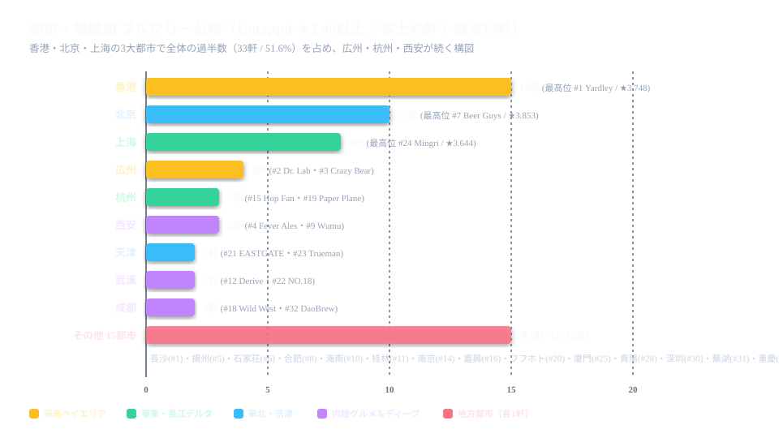

中国・香港のクラフトビールシーンは、この数年で急速に進化しています。かつては北京・上海の外国人街を中心としたパブ文化が主流でしたが、現在は地方都市からも世界基準の Hazy IPA やサワー、茶葉・スパイスを活かした個性派が続々と登場しています。

本記事では **2026年11月19日時点の Untappd データ** から、基準を **平均評価 ★3.40 以上** に揃えた **計64軒（中国本土 49軒 ＋ 香港 15軒）** を抽出。高鉄（高速鉄道）で巡りやすい **4つの周遊エリア** に整理してまとめました。

<a href="#overview" class="quick-jump-pill inline-flex items-center px-3 py-1.5 rounded-lg text-xs sm:text-sm font-semibold bg-slate-100 hover:bg-blue-50 text-slate-800 hover:text-blue-700 border border-slate-200 hover:border-blue-300 transition-all shadow-2xs">📊 全体像・マップ</a>
<a href="#area-1" class="quick-jump-pill inline-flex items-center px-3 py-1.5 rounded-lg text-xs sm:text-sm font-semibold bg-amber-50 hover:bg-amber-100 text-amber-900 border border-amber-200 hover:border-amber-300 transition-all shadow-2xs">① 華南ベイエリア（香港・広州・長沙）</a>
<a href="#area-2" class="quick-jump-pill inline-flex items-center px-3 py-1.5 rounded-lg text-xs sm:text-sm font-semibold bg-emerald-50 hover:bg-emerald-100 text-emerald-900 border border-emerald-200 hover:border-emerald-300 transition-all shadow-2xs">② 華東・長江デルタ（上海・杭州・南京）</a>
<a href="#area-3" class="quick-jump-pill inline-flex items-center px-3 py-1.5 rounded-lg text-xs sm:text-sm font-semibold bg-sky-50 hover:bg-sky-100 text-sky-900 border border-sky-200 hover:border-sky-300 transition-all shadow-2xs">③ 華北・京津（北京・天津・石家荘）</a>
<a href="#area-4" class="quick-jump-pill inline-flex items-center px-3 py-1.5 rounded-lg text-xs sm:text-sm font-semibold bg-purple-50 hover:bg-purple-100 text-purple-900 border border-purple-200 hover:border-purple-300 transition-all shadow-2xs">④ 内陸グルメ（西安・成都・重慶・武漢）</a>
<a href="#regional-column" class="quick-jump-pill inline-flex items-center px-3 py-1.5 rounded-lg text-xs sm:text-sm font-semibold bg-rose-50 hover:bg-rose-100 text-rose-900 border border-rose-200 hover:border-rose-300 transition-all shadow-2xs">🌏 地方注目ブルワリー</a>
<a href="#travel-tips" class="quick-jump-pill inline-flex items-center px-3 py-1.5 rounded-lg text-xs sm:text-sm font-semibold bg-slate-100 hover:bg-blue-50 text-slate-800 hover:text-blue-700 border border-slate-200 hover:border-blue-300 transition-all shadow-2xs">🚆 旅行者向けTips</a>
<a href="#appendix-data" class="quick-jump-pill inline-flex items-center px-3 py-1.5 rounded-lg text-xs sm:text-sm font-semibold bg-slate-100 hover:bg-blue-50 text-slate-800 hover:text-blue-700 border border-slate-200 hover:border-blue-300 transition-all shadow-2xs">📋 全64軒データ表</a>

> **💡 この記事の操作ヒント**: 表のヘッダー（`Untappd`・`ビール数`・`評価数` など）をクリックすると昇順・降順で並び替えられます。ブルワリー名をクリックすると Untappd ページへ移動します。

---

## 1. 全体像：データで見る中国・香港のクラフトビール

Untappd **★3.40 以上** の本土 49軒＋香港 15軒（計64軒）を俯瞰すると、**3つの傾向** が見えます。

1. **軒数は3大都市が過半数、上位は地方勢が席巻**
   - 香港（15軒）・北京（10軒）・上海（8軒）の3都市で全体の **51.6%（33/64軒）** を占めます。
   - 一方、本土 **Top 10 のうち7軒は北京・上海以外**（長沙 #1、広州 #2/#3、西安 #4、揚州 #5、石家荘 #6、合肥 #8、海南 #10）で、地方の実力派が高評価を独占しています。
2. **Nano Brewery の躍進**
   - 本土 49軒のうち **11軒が Nano Brewery**。#1 混沌酿造（★4.123）、#4 Fever Ales（★3.934）、#6 YE Brewing（★3.867）と最上位に食い込んでいます。直営タップルームを持たず委託醸造や都市部のビアバーへ卸す例も多く、事前の取扱店チェックが鍵になります。
3. **「老舗パイオニア」と「新世代ハイスコア勢」の二極化**
   - **Jing A（27,338件）**、**Great Leap（25,109件）**、**Slowboat（14,588件）**、**Boxing Cat（27,612件）**、**Gweilo（84,936件）**、**Young Master（58,314件）** などの老舗は、圧倒的な評価数と店舗網を持つ王道です。
   - 対して平均 **3.8〜4.1超** の新世代は、濃厚な Hazy IPA やフルーツ／ペイストリーサワーを小ロットで仕込むギーク向けが中心です。

---

## 2. エリア①【華南ベイエリア】香港 ⇄ 深圳 ⇄ 広州（＋長沙）

### エリア特徴と移動目安
* **収録数**: 香港 15軒 ＋ 広州 4軒 ＋ 深圳 1軒（＋延泊で長沙 1軒）
* **高鉄移動の目安（二等座片道）**:
  * 香港（西九龍） ⇄ 深圳（福田／深圳北）: **約15〜25分** / **約75元（約1,600円）**
  * 香港（西九龍） ⇄ 広州（広州南）: **約50〜60分** / **約215元（約4,600円）**（深圳からは約30〜40分）
  * 香港（西九龍） ⇄ 長沙（長沙南）: **約3〜3.5時間** / **約529元（約1.1万円）**（広州からは約2.5時間・約314元）
* **エリアの個性**: 日本から最も近く、週末＋1〜2日でも回れる王道ルート。英語が通じやすくビアバーが充実した**香港**と、本土屈指のハイスコア勢（#2 Dr. Lab・#3 Crazy Bear）が集まる**広州・海珠区**を一度に回れます。延泊すれば本土1位の**長沙「混沌酿造」**も射程圏内です。

### 注目ブルワリーピックアップ

### 1. 混沌酿造 (Chaosbrewing) — 本土 #1（長沙市）

📍 湖南省長沙市 / Nano Brewery

<a href="https://untappd.com/ChangShaChaobrewing" target="_blank" rel="noopener noreferrer" class="action-btn inline-flex items-center gap-1.5 px-3 py-1.5 rounded-lg text-xs sm:text-sm font-bold bg-amber-500 hover:bg-amber-600 text-white shadow-2xs transition-colors">🍺 Untappd</a>
<a href="https://www.chaobrewing.cn/men-dian" target="_blank" rel="noopener noreferrer" class="action-btn inline-flex items-center gap-1.5 px-3 py-1.5 rounded-lg text-xs sm:text-sm font-bold bg-slate-800 hover:bg-slate-900 text-white shadow-2xs transition-colors">🌐 公式店舗案内</a>

* **Untappd ブルワリー評価**: **4.123**（105種 / 1,120件）
* **直営タップルーム**: **あり**（長沙市内2店舗 / [🍺 Untappd](https://untappd.com/ChangShaChaobrewing) / [🌐 公式案内](https://www.chaobrewing.cn/men-dian)）
  * **五一広場店**: 湖南省長沙市開福区黄興北路111号（上城金都后街）— 繁華街近くで湖南料理と合わせやすい（[📍 Google Map](https://www.google.com/maps/search/?api=1&query=%E6%B9%96%E5%8D%97%E7%9C%81%E9%95%BF%E6%B2%99%E5%B8%82%E5%BC%80%E7%A6%8F%E5%8C%BA%E9%BB%84%E5%85%B4%E5%8C%97%E8%B7%AF111%E5%8F%B7)）
  * **黄土嶺店**: 湖南省長沙市雨花区建発中央公園9棟西側駐車場入口旁（[📍 Google Map](https://www.google.com/maps/search/?api=1&query=%E6%B9%96%E5%8D%97%E7%9C%81%E9%95%BF%E6%B2%99%E5%B8%82%E9%9B%A8%E8%8A%B1%E5%8C%BA%E5%BB%BA%E5%8F%91%E4%B8%AD%E5%A4%AE%E5%85%AC%E5%9B%AD9%E6%A0%8B)）
* **特徴・スタイル**: 本土1位（唯一の4.1点台）。ジューシーな Hazy IPA や Double / Triple IPA などホップ主体のビールで熱狂的な支持を集める。
* **代表・高評価ビール**:
  * **藤影 (Vine Soul)**（Imperial Hazy IPA / **Untappd: 4.4**）
  * **拾合 (One Liter)**（ESB / **Untappd: 4.1**） / **TDH耦合**（Triple IPA / **Untappd: 4.1**）

### 2. Dr. Lab / Crazy Bear Industry (疯熊工業) — 本土 #2・#3（広州市）

📍 広東省広州市（海珠区） / Micro Brewery

<a href="https://untappd.com/w/dr-lab/522484" target="_blank" rel="noopener noreferrer" class="action-btn inline-flex items-center gap-1.5 px-3 py-1.5 rounded-lg text-xs sm:text-sm font-bold bg-amber-500 hover:bg-amber-600 text-white shadow-2xs transition-colors">🍺 Dr. Lab</a>
<a href="https://untappd.com/CBIB" target="_blank" rel="noopener noreferrer" class="action-btn inline-flex items-center gap-1.5 px-3 py-1.5 rounded-lg text-xs sm:text-sm font-bold bg-amber-500 hover:bg-amber-600 text-white shadow-2xs transition-colors">🍺 Crazy Bear</a>

* **Untappd ブルワリー評価**:
  * **Dr. Lab**: **4.047**（178種 / 1,562件）
  * **Crazy Bear Industry**: **3.937**（171種 / 5,913件）
* **直営タップルーム**: **2軒ともあり**（ともに**広州市海珠区**の近接エリアで1晩にハシゴ可能）
  * **Dr. Lab**: [📍 Google Map](https://www.google.com/maps/search/?api=1&query=DR+LAB+%E7%B2%BE%E9%85%BF%E5%95%A4%E9%85%92%E5%B7%A5%E4%BD%9C%E5%AE%A4+%E5%B9%BF%E5%B7%9E%E6%B5%B7%E7%8F%A0) / [🍺 Untappd](https://untappd.com/w/dr-lab/522484)
  * **Crazy Bear Lab**: 怡安路152号（[📍 Google Map](https://www.google.com/maps/search/?api=1&query=Crazy+Bear+Lab+%E5%B9%BF%E5%B7%9E%E5%B8%82%E6%B5%B7%E7%8F%A0%E5%8C%BA%E6%80%A1%E5%AE%89%E8%B7%AF152%E5%8F%B7) / [🍺 Untappd](https://untappd.com/CBIB)）
* **特徴・スタイル**: **Dr. Lab** は隠れ家的な空間で、フルーツ／ハーブ系やハウスサイダー、限定タップを提供。**Crazy Bear** は2018年に海珠区で創業（醸造所は東莞）し、IPA やスタウトを幅広く展開。
* **代表・高評価ビール**:
  * **Dr. Lab**: *P01 进击的二筒*（Porter）、*C20 茉语青藤*（Herbed Cider）等の実験的シリーズが **Untappd: 4.0〜4.2+**
  * **Crazy Bear**: *月牙泉-酒花拉格*（IPL / **Untappd: 4.1**）、*冷岸*（EPA / **Untappd: 4.0**）、*云镜*（Imperial Hazy IPA / **Untappd: 4.0**）、*分影-DDH*（DDH IPA / **Untappd: 4.0**）

### 3. Yardley Brothers / Carbon Brews / Young Master (少爺啤) — 香港トップ勢

📍 香港（香港島・新界・九龍） / Micro Brewery

<a href="https://untappd.com/YardleyBrothers" target="_blank" rel="noopener noreferrer" class="action-btn inline-flex items-center gap-1.5 px-3 py-1.5 rounded-lg text-xs sm:text-sm font-bold bg-amber-500 hover:bg-amber-600 text-white shadow-2xs transition-colors">🍺 Yardley</a>
<a href="https://untappd.com/CarbonBrews" target="_blank" rel="noopener noreferrer" class="action-btn inline-flex items-center gap-1.5 px-3 py-1.5 rounded-lg text-xs sm:text-sm font-bold bg-amber-500 hover:bg-amber-600 text-white shadow-2xs transition-colors">🍺 Carbon</a>
<a href="https://untappd.com/YoungMasterAles" target="_blank" rel="noopener noreferrer" class="action-btn inline-flex items-center gap-1.5 px-3 py-1.5 rounded-lg text-xs sm:text-sm font-bold bg-amber-500 hover:bg-amber-600 text-white shadow-2xs transition-colors">🍺 Young Master</a>

* **Untappd ブルワリー評価**:
  * **Yardley Brothers（香港 #1）**: **3.748**（221種 / 17,404件）
  * **Carbon Brews（香港 #2）**: **3.688**（164種 / 17,124件）
  * **Young Master Brewery 少爺啤（香港 #5）**: **3.639**（325種 / 58,314件）
* **直営タップルーム ＆ 代表ビール**:
  * **Yardley Brothers**: **直営あり**（中環 Soho *Yardleys Taproom*・ラマ島 *The Beer Shack* / [📍 Google Map](https://www.google.com/maps/search/?api=1&query=Yardleys+Taproom+Central+Hong+Kong) / [🍺 Untappd](https://untappd.com/YardleyBrothers)）。代表作 *Hong Kong Bastard*（IIPA・7.8% / **Untappd: 3.82** / Beertopia Best in Show）。
  * **Carbon Brews**: **直営なし（ビアバー・ボトルショップ流通中心）**（[🍺 Untappd](https://untappd.com/CarbonBrews)）。人気作 *Crazy Rich Lupulins*（Imperial Hazy IPA / **Untappd: 3.8**）、*Earth People*（Light Lager / **Untappd: 3.6**）。
  * **Young Master 少爺啤**: **直営あり**（中環 *BaseHall 01* 等 / [📍 Google Map](https://www.google.com/maps/search/?api=1&query=Young+Master+Central+BaseHall+Hong+Kong) / [🍺 Untappd](https://untappd.com/YoungMasterAles)）。定番 *Cha Chaan Teng Gose (鹹檸啤)*（Fruited Gose / **Untappd: 3.53**・3,300件超）。

### エリア① ブルワリー一覧（本土 Top 50 該当分＋香港上位抜粋）

| 区分・順位 | ブルワリー名 | 都市・エリア | タイプ | Untappd | ビール数 | 評価数 |
|---:|---|---|---|---:|---:|---:|
| 本土 #1 | [混沌酿造 (Chaosbrewing)](https://untappd.com/ChangShaChaobrewing) | 長沙市 (湖南省) | Nano Brewery | 4.123 | 105 | 1,120 |
| 本土 #2 | [Dr. Lab](https://untappd.com/w/dr-lab/522484) | 広州市 (広東省) | Micro Brewery | 4.047 | 178 | 1,562 |
| 本土 #3 | [Crazy Bear Industry (疯熊工業)](https://untappd.com/CBIB) | 広州市 (広東省) | Micro Brewery | 3.937 | 171 | 5,913 |
| 本土 #30 | [E.T. Brewery](https://untappd.com/w/e-t-brewery/316168) | 深圳市 (広東省) | Brew Pub | 3.572 | 175 | 2,572 |
| 本土 #33 | [The Strand Brewery And Cafe](https://untappd.com/TheStrandBrewery) | 広州市 (広東省) | Micro Brewery | 3.555 | 82 | 1,150 |
| 本土 #42 | [Bravo Brewing Co. (保霖精酿)](https://untappd.com/w/bravo-brewing-co-a-e-c2-e/290538) | 広州市 (広東省) | Brew Pub | 3.479 | 132 | 2,907 |
| 香港 #1 | [Yardley Brothers](https://untappd.com/YardleyBrothers) | 新界 (Lamma / Soho) | Micro Brewery | 3.748 | 221 | 17,404 |
| 香港 #2 | [Carbon Brews](https://untappd.com/CarbonBrews) | 新界 (Fo Tan) | Micro Brewery | 3.688 | 164 | 17,124 |
| 香港 #3 | [Richkat Craft Brewing 貓員外精釀啤酒](https://untappd.com/Rich_Kat_) | 香港島 | Brew Pub | 3.656 | 47 | 3,768 |
| 香港 #4 | [Heroes Beer Co.](https://untappd.com/HeroesBeerCo) | 香港島 | Micro Brewery | 3.641 | 122 | 15,699 |
| 香港 #5 | [Young Master Brewery 少爺啤](https://untappd.com/YoungMasterAles) | 香港島 | Micro Brewery | 3.639 | 325 | 58,314 |
| 香港 #6 | [Hong Kong Beer Co.](https://untappd.com/HKBeerCo) | 九龍 | Micro Brewery | 3.601 | 146 | 22,293 |
| 香港 #7 | [Deadman Brewery](https://untappd.com/DeadmanBreweryHK) | 九龍 | Nano Brewery | 3.595 | 100 | 4,674 |
| 香港 #8 | [Gweilo Beer](https://untappd.com/Gweilo_Beer) | 香港島 | Micro Brewery | 3.553 | 106 | 84,936 |

---

## 3. エリア②【華東・長江デルタ】上海 ⇄ 杭州（＋嘉興・紹興・揚州・南京）

### エリア特徴と移動目安
* **収録数**: 上海 8軒 ＋ 浙江 5軒（杭州 3・嘉興 1・紹興 1）＋ 江蘇 2軒（揚州 1・南京 1）＝ **計15軒**
* **高鉄移動の目安（二等座片道）**:
  * 上海（虹橋） ⇄ 杭州（杭州東）: **約45分〜1時間** / **約60〜75元（約1,300〜1,600円）**（嘉興・紹興も同路線で近接）
  * 上海 ⇄ 南京（南京南）: **約1〜1.5時間** / **約130〜150元（約2,800〜3,200円）**
  * 南京 ⇄ 揚州（揚州東）: **約50分** / **約65元（約1,400円）**
* **エリアの個性**: 高鉄網が最も密で、上海を拠点に**江蘇・浙江の実力派を日帰りで網羅**可能。上海の大型ブルーパブ（*Liquid Laundry*、*Boxing Cat* 等）や *Mingri* に加え、杭州・揚州・南京の **★3.7〜3.9台** の実力派を効率よく巡れます。

### 注目ブルワリーピックアップ

### 1. SUIWU BREWING (虽吾酿造) — 本土 #5（揚州市）

📍 江蘇省揚州市 / Micro Brewery
<a href="https://untappd.com/Suiwu_jennifer" target="_blank" rel="noopener noreferrer" class="action-btn inline-flex items-center gap-1.5 px-3 py-1.5 rounded-lg text-xs sm:text-sm font-bold bg-amber-500 hover:bg-amber-600 text-white shadow-2xs transition-colors">🍺 Untappd</a>

* **Untappd ブルワリー評価**: **3.907**（53種 / 1,539件）
* **直営タップルーム**: **なし（全国のビアバー・ボトルショップ卸売中心）**。上海・杭州・北京などの主要クラフトビアバー（*North Bank* 等）で樽生が繋がりやすい。
* **代表・高評価ビール**: 銘柄数を絞りつつ完成度が高く、*Above the Clouds (飞越云海)*（IIPA / **Untappd: 4.0**）、*Untitled Journey (无言之旅)*（Triple IPA / **Untappd: 3.89**）、*Nelson Harvest (尼尔森采收- 晚采)*（Triple IPA）やチェコピルスナー *小金狼* が人気。

### 2. Hop Fan (或不凡) / Paper Plane Brewing (紙飛機釀造) — 本土 #15・#19（杭州市）

📍 浙江省杭州市 / Micro Brewery

<a href="https://untappd.com/w/hop-fan/385711" target="_blank" rel="noopener noreferrer" class="action-btn inline-flex items-center gap-1.5 px-3 py-1.5 rounded-lg text-xs sm:text-sm font-bold bg-amber-500 hover:bg-amber-600 text-white shadow-2xs transition-colors">🍺 Hop Fan</a>
<a href="https://untappd.com/Paper_Plane_Brewing" target="_blank" rel="noopener noreferrer" class="action-btn inline-flex items-center gap-1.5 px-3 py-1.5 rounded-lg text-xs sm:text-sm font-bold bg-amber-500 hover:bg-amber-600 text-white shadow-2xs transition-colors">🍺 Paper Plane</a>

* **Untappd ブルワリー評価**:
  * **Hop Fan (或不凡)**: **3.747**（86種 / 5,201件）
  * **Paper Plane Brewing (紙飛機釀造)**: **3.730**（134種 / 3,296件）
* **直営タップルーム**: **2軒ともなし（全国のビアバー・缶流通中心）**。杭州・上海のクラフトビアバーやボトルショップで広く扱われている。
* **代表・高評価ビール**:
  * **Hop Fan**: *白蛇 (White Snake)*（Strong Ale / **Untappd: 4.0**）、*龍王 (Dragon King)*（Hazy IPA / **Untappd: 3.9**）、*青蛇 (Green Snake)*（IPA / **Untappd: 3.72**）など。
  * **Paper Plane**: 2018年創業、IPA と濃厚なフルーツサワーが得意。*临界桃红版*（Imperial Hazy IPA / **Untappd: 4.0**）、*阿达杏三倍杏桃奶昔冰激凌酸艾尔*（Fruited Sour / **Untappd: 3.9**）。

### 3. Mingri Brewing (明日酿造) / Liquid Laundry — 本土 #24・#38（上海市）

📍 上海市 / Micro Brewery・Brew Pub

<a href="https://untappd.com/MingriBrewing" target="_blank" rel="noopener noreferrer" class="action-btn inline-flex items-center gap-1.5 px-3 py-1.5 rounded-lg text-xs sm:text-sm font-bold bg-amber-500 hover:bg-amber-600 text-white shadow-2xs transition-colors">🍺 Mingri</a>
<a href="https://untappd.com/LiquidLaundry" target="_blank" rel="noopener noreferrer" class="action-btn inline-flex items-center gap-1.5 px-3 py-1.5 rounded-lg text-xs sm:text-sm font-bold bg-amber-500 hover:bg-amber-600 text-white shadow-2xs transition-colors">🍺 Liquid Laundry</a>

* **Untappd ブルワリー評価**:
  * **Mingri Brewing (明日酿造)**: **3.644**（299種 / 6,150件）
  * **Liquid Laundry**: **3.519**（119種 / 3,146件）
* **直営タップルーム ＆ 代表ビール**:
  * **Mingri**: **直営あり**（蘇州河沿い：黄浦区新閘路356号 / [📍 Google Map](https://www.google.com/maps/search/?api=1&query=%E6%98%8E%E6%97%A5%E9%85%BF%E9%80%A0+%E4%B8%8A%E6%B5%B7%E5%B8%82%E9%BB%84%E6%B5%A6%E5%8C%BA%E6%96%B0%E9%97%B8%E8%B7%AF356%E5%8F%B7) / [🍺 Untappd](https://untappd.com/MingriBrewing)）。*北境之光*（IPA / **Untappd: 3.9**）、*超级物种酒花甄选版*（Imperial Hazy IPA / **Untappd: 3.8**）、看板 *Hazy Dream (朦胧的梦)*（Hazy IPA / **Untappd: 3.7**・600件超）。
  * **Liquid Laundry**: **直営あり（ブルーパブ）**（淮海中路 / [📍 Google Map](https://www.google.com/maps/search/?api=1&query=Liquid+Laundry+Shanghai) / [🍺 Untappd](https://untappd.com/LiquidLaundry)）。人気作 *Breast Wishes Milk Stout*（Milk Stout / **Untappd: 3.7**）と窯焼きピザのペアリングが定番。

### エリア② ブルワリー一覧（全15軒）

| 順位 | ブルワリー名 | 都市・地域 | タイプ | Untappd | ビール数 | 評価数 |
|---:|---|---|---|---:|---:|---:|
| #5 | [SUIWU BREWING (虽吾酿造)](https://untappd.com/Suiwu_jennifer) | 揚州市 (江蘇省) | Micro Brewery | 3.907 | 53 | 1,539 |
| #14 | [Injoy (制乐厂)](https://untappd.com/w/injoy/542129) | 南京市 (江蘇省) | Micro Brewery | 3.751 | 73 | 1,279 |
| #15 | [Hop Fan (或不凡)](https://untappd.com/w/hop-fan/385711) | 杭州市 (浙江省) | Micro Brewery | 3.747 | 86 | 5,201 |
| #16 | [Bubble Lab Brewery (气泡实验室)](https://untappd.com/BubbleLab) | 嘉興市 (浙江省) | Micro Brewery | 3.745 | 97 | 4,340 |
| #19 | [Paper Plane Brewing 紙飛機釀造](https://untappd.com/Paper_Plane_Brewing) | 杭州市 (浙江省) | Micro Brewery | 3.730 | 134 | 3,296 |
| #24 | [Mingri Brewing (明日酿造)](https://untappd.com/MingriBrewing) | 上海市 | Micro Brewery | 3.644 | 299 | 6,150 |
| #35 | [Sheng Craft Beer (山乘酿造)](https://untappd.com/w/sheng-craft-beer/502580) | 紹興市 (浙江省) | Nano Brewery | 3.544 | 190 | 3,383 |
| #37 | [Dream Brewing (梦想酿造)](https://untappd.com/DreamBrew) | 上海市 | Micro Brewery | 3.531 | 157 | 4,055 |
| #38 | [Liquid Laundry](https://untappd.com/LiquidLaundry) | 上海市 | Brew Pub | 3.519 | 119 | 3,146 |
| #39 | [Mad Dragon - Shanghai](https://untappd.com/w/mad-dragon-shanghai/367281) | 上海市 | Brew Pub | 3.507 | 7 | 1,234 |
| #43 | [Goose Island Shanghai](https://untappd.com/w/goose-island-shanghai/330405) | 上海市 | Brew Pub | 3.451 | 146 | 6,359 |
| #45 | [Boxing Cat Brewery (拳击猫)](https://untappd.com/boxingcatbrewery) | 上海市 | Macro Brewery | 3.422 | 224 | 27,612 |
| #46 | [Postwave 厚浪](https://untappd.com/w/postwave/476397) | 上海市 | Micro Brewery | 3.411 | 44 | 1,245 |
| #48 | [申爱 Shanghai Love](https://untappd.com/w/shanghai-love/287560) | 上海市 | Micro Brewery | 3.406 | 25 | 1,326 |
| #49 | [Taste Room (忒斯特)](https://untappd.com/w/taste-room/333875) | 杭州市 (浙江省) | Nano Brewery | 3.404 | 86 | 1,908 |

---

## 4. エリア③【華北・京津】北京 ⇄ 天津（＋石家荘）

### エリア特徴と移動目安
* **収録数**: 北京 10軒 ＋ 天津 2軒（＋延泊で石家荘 1軒）＝ **計13軒**
* **高鉄移動の目安（二等座片道）**:
  * 北京（北京南） ⇄ 天津: **約30〜40分** / **約55〜66元（約1,200〜1,400円）**
  * 北京（北京西） ⇄ 石家荘: **約1〜1.5時間** / **約101〜155元（約2,200〜3,300円）**
* **エリアの個性**: 中国クラフト発祥の地であり本土最多の10軒が集中。胡同（フートン）の **Great Leap** や **Arrow Factory**、鼓楼の **Beer Guys**・**Wild Kite**、三里屯の **Slowboat** など伝統と現代が交差する名店が揃います。天津・石家荘勢も北京内に店舗や流通網があり、北京滞在だけで華北の精鋭をほぼ網羅できます。

### 注目ブルワリーピックアップ

### 1. YE Brewing (野鹅微醺) — 本土 #6（石家荘市 / 北京にタップルームあり）

📍 河北省石家荘市（北京市にも直営店あり） / Nano Brewery
<a href="https://untappd.com/YEBrewing" target="_blank" rel="noopener noreferrer" class="action-btn inline-flex items-center gap-1.5 px-3 py-1.5 rounded-lg text-xs sm:text-sm font-bold bg-amber-500 hover:bg-amber-600 text-white shadow-2xs transition-colors">🍺 Untappd</a>

* **Untappd ブルワリー評価**: **3.867**（293種 / 9,881件）
* **直営タップルーム**: **あり**（石家荘に加え、北京に *Ye Brewing Beijing Taproom / 野鹅微醺公园* あり / [📍 Google Map（北京店）](https://www.google.com/maps/search/?api=1&query=%E9%87%8E%E9%B9%85%E5%BE%AE%E9%86%BA+%E5%8C%97%E4%BA%AC) / [🍺 Untappd](https://untappd.com/YEBrewing)）
* **特徴・代表ビール**: 濃厚な Hazy IPA とスタウトの評価が極めて高く、評価数は1万件目前。
  * *云雾之湾 (Cloudy Bay)*（Imperial NEIPA / **Untappd: 4.1**） / *夜莺四周年特别款*（Imperial Stout / **Untappd: 4.1**）
  * *Nighting-Ale (夜莺)*（Imperial Pastry Stout / **Untappd: 4.0**・650件超） / *橙多多*（Hazy IPA / **Untappd: 3.8**）

### 2. Beer Guys (啤酒帮) / Quadraft Brewing (分野酿造) — 本土 #7・#13（北京市）

📍 北京市 / Nano Brewery

<a href="https://untappd.com/w/beer-guys/408472" target="_blank" rel="noopener noreferrer" class="action-btn inline-flex items-center gap-1.5 px-3 py-1.5 rounded-lg text-xs sm:text-sm font-bold bg-amber-500 hover:bg-amber-600 text-white shadow-2xs transition-colors">🍺 Beer Guys</a>
<a href="https://untappd.com/w/quadraft-brewing/525913" target="_blank" rel="noopener noreferrer" class="action-btn inline-flex items-center gap-1.5 px-3 py-1.5 rounded-lg text-xs sm:text-sm font-bold bg-amber-500 hover:bg-amber-600 text-white shadow-2xs transition-colors">🍺 Quadraft</a>

* **Untappd ブルワリー評価**:
  * **Beer Guys (啤酒帮)**: **3.853**（62種 / 1,420件）
  * **Quadraft Brewing (分野酿造)**: **3.777**（159種 / 3,163件）
* **直営タップルーム ＆ 代表ビール**:
  * **Beer Guys**: **直営あり**（東城区・旧鼓楼大街91号 / [📍 Google Map](https://www.google.com/maps/search/?api=1&query=Beer+Guys+%E5%8C%97%E4%BA%AC%E5%B8%82%E4%B8%9C%E5%9F%8E%E5%8C%BA%E6%97%A7%E9%BC%93%E6%A5%BC%E5%A4%A7%E8%A1%9791%E5%8F%B7) / [🍺 Untappd](https://untappd.com/w/beer-guys/408472)）。自社銘柄に加え各地のゲストタップが充実。*松枝 IPA (Pine Branch IPA)*（**Untappd: 3.9**）、*糯香 (Nuoxiang)*（English Pale Ale / **Untappd: 3.9**）。
  * **Quadraft**: **直営なし（北京等のビアバー中心）**（[🍺 Untappd](https://untappd.com/w/quadraft-brewing/525913)）。*El Nido* や *Companion Taproom（伴饮酒馆）* 等で提供。*美洲豹 (Jaguar)*（Mexican Lager / **Untappd: 3.8**）、*红蜻蜓 (Red Dragonfly)*（German Pilsner / **Untappd: 3.8**）、*大象 (Elephant)*（Sour IPA / **Untappd: 3.8**）。

### 3. 北京パイオニア四天王：Jing A / Slowboat / NBeer / Great Leap

📍 北京市 / Micro Brewery

<a href="https://untappd.com/JingABrewingCo" target="_blank" rel="noopener noreferrer" class="action-btn inline-flex items-center gap-1 px-2.5 py-1 rounded-lg text-xs font-bold bg-amber-500 hover:bg-amber-600 text-white">🍺 Jing A</a>
<a href="https://untappd.com/slowboatbrewery" target="_blank" rel="noopener noreferrer" class="action-btn inline-flex items-center gap-1 px-2.5 py-1 rounded-lg text-xs font-bold bg-amber-500 hover:bg-amber-600 text-white">🍺 Slowboat</a>
<a href="https://untappd.com/NBeerPub" target="_blank" rel="noopener noreferrer" class="action-btn inline-flex items-center gap-1 px-2.5 py-1 rounded-lg text-xs font-bold bg-amber-500 hover:bg-amber-600 text-white">🍺 NBeer</a>
<a href="https://untappd.com/greatleapbeer" target="_blank" rel="noopener noreferrer" class="action-btn inline-flex items-center gap-1 px-2.5 py-1 rounded-lg text-xs font-bold bg-amber-500 hover:bg-amber-600 text-white">🍺 Great Leap</a>

* **Untappd ブルワリー評価**: Jing A (**3.616** / 27,338件)、Slowboat (**3.579** / 14,588件)、NBeer (**3.537** / 8,911件)、Great Leap (**3.482** / 25,109件)
* **直営タップルーム ＆ 代表ビール**（**全4軒とも北京市内に直営あり**）:
  * **Great Leap（大跃啤酒）**: 2010年創業。*豆角胡同6号（Hutong #6）* の四合院が聖地（[📍 Google Map](https://www.google.com/maps/search/?api=1&query=Great+Leap+Brewing+No.6+Doujiao+Hutong+Beijing) / [🍺 Untappd](https://untappd.com/greatleapbeer)）。名物 *Honey Ma Gold (甫子啤酒)*（花椒・蜂蜜 / **Untappd: 3.4**・2,590件超）。
  * **Slowboat（悠航鲜啤）**: 三里屯の大型ブルーパブが定番（[📍 Google Map](https://www.google.com/maps/search/?api=1&query=Slow+Boat+Brewery+Sanlitun+Beijing) / [🍺 Untappd](https://untappd.com/slowboatbrewery)）。看板 *Monkey's Fist IPA (猴拳IPA)*（**Untappd: 3.69**・1,620件超 / Imperial版は **Untappd: 3.8**）。
  * **NBeer（牛啤堂）**: 自社醸造に加え各地の独立ブルワリーを多数繋ぐ（[📍 Google Map](https://www.google.com/maps/search/?api=1&query=NBeer+Pub+Beijing) / [🍺 Untappd](https://untappd.com/NBeerPub)）。人気作 *Beijing Gose Modern (帝都海盐)*（**Untappd: 3.6**・1,300件超）。
  * **Jing A（京A）**: 都心各所に大型タップルームを展開（[📍 Google Map](https://www.google.com/maps/search/?api=1&query=Jing+A+Taproom+Beijing) / [🍺 Untappd](https://untappd.com/JingABrewingCo)）。*Airpocalypse (空气大爆表)*（IIPA / **Untappd: 3.8**・1,190件超）、*Worker's Pale Ale (工人)*（**Untappd: 3.5**・2,630件超）。

### エリア③ ブルワリー一覧（全13軒）

| 順位 | ブルワリー名 | 都市・地域 | タイプ | Untappd | ビール数 | 評価数 |
|---:|---|---|---|---:|---:|---:|
| #6 | [YE Brewing (野鹅微醺)](https://untappd.com/YEBrewing) | 石家荘市 (河北省) | Nano Brewery | 3.867 | 293 | 9,881 |
| #7 | [Beer Guys (啤酒帮)](https://untappd.com/w/beer-guys/408472) | 北京市 | Nano Brewery | 3.853 | 62 | 1,420 |
| #13 | [Quadraft Brewing (分野酿造)](https://untappd.com/w/quadraft-brewing/525913) | 北京市 | Nano Brewery | 3.777 | 159 | 3,163 |
| #17 | [Wild Kite (野风筝)](https://untappd.com/Wild_Kite_Bar) | 北京市 | Nano Brewery | 3.743 | 96 | 1,888 |
| #21 | [EASTGATE（青門）](https://untappd.com/eastgatecn) | 天津市 | Micro Brewery | 3.683 | 95 | 1,081 |
| #23 | [楚门津酿 Trueman Brewing Co.](https://untappd.com/TruemanBrewing) | 天津市 | Micro Brewery | 3.661 | 123 | 2,914 |
| #26 | [Jing A (京A) Brewing Co.](https://untappd.com/JingABrewingCo) | 北京市 | Micro Brewery | 3.616 | 362 | 27,338 |
| #27 | [Arrow Factory Brewing 箭厂啤酒](https://untappd.com/ArrowFactoryBrewing) | 北京市 | Micro Brewery | 3.611 | 62 | 3,396 |
| #29 | [SLOWBOAT BREWING 悠航鲜啤](https://untappd.com/slowboatbrewery) | 北京市 | Micro Brewery | 3.579 | 524 | 14,588 |
| #36 | [NBeer Craft Brewing Co. 牛啤堂](https://untappd.com/NBeerPub) | 北京市 | Micro Brewery | 3.537 | 99 | 8,911 |
| #40 | [Beersmith 鲜啤吧](https://untappd.com/BeersmithBeijing) | 北京市 | Brew Pub | 3.489 | 167 | 1,805 |
| #41 | [Great Leap Brewing (大跃啤酒)](https://untappd.com/greatleapbeer) | 北京市 | Micro Brewery | 3.482 | 287 | 25,109 |
| #47 | [Red Ears Brewing (赤耳酿造)](https://untappd.com/w/red-ears-brewing/470312) | 北京市 | Nano Brewery | 3.410 | 118 | 2,705 |

---

## 5. エリア④【内陸グルメ＆ディープ】西安 ⇄ 成都 ⇄ 重慶（＋武漢）

### エリア特徴と移動目安
* **収録数**: 西安 3軒 ＋ 成都 2軒 ＋ 重慶 1軒（＋武漢 2軒）＝ **計8軒**
* **高鉄移動の目安（二等座片道）**:
  * 西安（西安北） ⇄ 成都（成都東）: **約3.5〜4.5時間** / **約263〜316元（約5,600〜6,800円）**
  * 成都 ⇄ 重慶（重慶西）: **約1〜1.5時間** / **約157〜166元（約3,400〜3,600円）**
  * 西安 ⇄ 武漢: **約3〜4時間** / **約407元（約8,700円）**
* **エリアの個性**: 火鍋・麻婆豆腐・羊肉泡饃・熱乾麺など**中国屈指のグルメ都市**とビールを掛け合わせるルート。西安（#4 Fever Ales, #9 Wumu）や武漢（#12 Derive, #22 NO.18）は全国屈指の激戦区で、茶葉・スパイス・地元の米を活かしたビールが光ります。

### 注目ブルワリーピックアップ

### 1. Fever Ales / Wumu Craft Beer (勿幕精酿) — 本土 #4・#9（西安市）

📍 陝西省西安市 / Nano Brewery・Brew Pub

<a href="https://untappd.com/FeverAles" target="_blank" rel="noopener noreferrer" class="action-btn inline-flex items-center gap-1.5 px-3 py-1.5 rounded-lg text-xs sm:text-sm font-bold bg-amber-500 hover:bg-amber-600 text-white shadow-2xs transition-colors">🍺 Fever Ales</a>
<a href="https://untappd.com/w/wumu-craft-beer/383025" target="_blank" rel="noopener noreferrer" class="action-btn inline-flex items-center gap-1.5 px-3 py-1.5 rounded-lg text-xs sm:text-sm font-bold bg-amber-500 hover:bg-amber-600 text-white shadow-2xs transition-colors">🍺 Wumu</a>

* **Untappd ブルワリー評価**:
  * **Fever Ales**: **3.934**（281種 / **10,706件**）
  * **Wumu Craft Beer (勿幕精酿)**: **3.831**（179種 / 3,257件）
* **直営タップルーム ＆ 代表ビール**:
  * **Fever Ales**: **直営なし（西安市内や全国のビアバー流通中心）**（[🍺 Untappd](https://untappd.com/FeverAles)）。実験的セゾンやラガーが高評価。*以酒为舟*（Saison / **Untappd: 4.3**）、*白拉格 Lager De Blanc*（**Untappd: 4.0**）、*春狩*（Wild Ale / **Untappd: 4.0**）、*全明*（Helles / **Untappd: 3.9**）。
  * **Wumu**: **直営あり（ブルーパブ）**（西安城壁南門・小南門エリア / [📍 Google Map](https://www.google.com/maps/search/?api=1&query=%E5%8B%BF%E5%B9%95%E7%B2%BE%E9%85%BF+%E8%A5%BF%E5%AE%89%E5%B0%8F%E5%8D%97%E9%97%A8) / [🍺 Untappd](https://untappd.com/w/wumu-craft-beer/383025)）。*克里特·草药*（IPL / **Untappd: 3.8**）、*烟熏乌梅*（Porter / **Untappd: 3.7**）。

### 2. Derive Brewery (蔓延酿造) / NO.18 BREWING & CO. (拾捌精酿) — 本土 #12・#22（武漢市）

📍 湖北省武漢市 / Nano Brewery・Micro Brewery

<a href="https://untappd.com/DeriveBrewery" target="_blank" rel="noopener noreferrer" class="action-btn inline-flex items-center gap-1.5 px-3 py-1.5 rounded-lg text-xs sm:text-sm font-bold bg-amber-500 hover:bg-amber-600 text-white shadow-2xs transition-colors">🍺 Derive</a>
<a href="https://untappd.com/NO18BREWINGCO" target="_blank" rel="noopener noreferrer" class="action-btn inline-flex items-center gap-1.5 px-3 py-1.5 rounded-lg text-xs sm:text-sm font-bold bg-amber-500 hover:bg-amber-600 text-white shadow-2xs transition-colors">🍺 NO.18</a>

* **Untappd ブルワリー評価**:
  * **Derive Brewery (蔓延酿造)**: **3.784**（85種 / 1,791件）
  * **NO.18 BREWING & CO. (拾捌精酿)**: **3.664**（176種 / **12,625件**）
* **直営タップルーム ＆ 代表ビール**:
  * **Derive Brewery**: **直営なし（武漢・上海・北京等のビアバー卸売中心）**（[🍺 Untappd](https://untappd.com/DeriveBrewery)）。独自の酵母バンクでクラシックを再編集。*背向的站姿*（IPA / **Untappd: 4.0**）、*Lima (利马)*（Imperial Hazy IPA / **Untappd: 3.9**・118件超）、*貌似通用的筹码*（Pilsner / **Untappd: 3.7**）。
  * **NO.18**: **直営あり（武漢市内にブルーパブ）**（江漢区京漢大道923号 / [📍 Google Map](https://www.google.com/maps/search/?api=1&query=%E6%8B%BE%E6%8D%8C%E7%B2%BE%E9%85%BF+%E6%AD%A6%E6%B1%89%E5%B8%82%E6%B1%9F%E6%B1%89%E5%8C%BA%E4%BA%AC%E6%B1%89%E5%A4%A7%E9%81%93923%E5%8F%B7) / [🍺 Untappd](https://untappd.com/NO18BREWINGCO)）。*Ling Bo Men (凌波门)*（Hazy IPA / **Untappd: 3.8**）、*全明星2025五星上将*（IPA / **Untappd: 3.8**）、*No Criticism (不接受批评)*（Session IPA / **Untappd: 3.5**）。

### 3. Wild West Brewing (美西) / Hopscraft (立吞) — 本土 #18（成都）・#34（重慶）

📍 四川省成都市・重慶市 / Micro Brewery・Brew Pub

<a href="https://untappd.com/Wild_West_Brewing" target="_blank" rel="noopener noreferrer" class="action-btn inline-flex items-center gap-1.5 px-3 py-1.5 rounded-lg text-xs sm:text-sm font-bold bg-amber-500 hover:bg-amber-600 text-white shadow-2xs transition-colors">🍺 Wild West</a>
<a href="https://untappd.com/w/hopscraft/430416" target="_blank" rel="noopener noreferrer" class="action-btn inline-flex items-center gap-1.5 px-3 py-1.5 rounded-lg text-xs sm:text-sm font-bold bg-amber-500 hover:bg-amber-600 text-white shadow-2xs transition-colors">🍺 Hopscraft</a>

* **Untappd ブルワリー評価**: Wild West (**3.733** / 8,601件)、Hopscraft (**3.552** / 1,676件)
* **直営タップルーム ＆ 代表ビール**（**2軒とも直営あり**）:
  * **Wild West**: **直営あり**（成都・武侯区玉林中路32号 等 / [📍 Google Map](https://www.google.com/maps/search/?api=1&query=Wild+West+Brewing+%E6%88%90%E9%83%BD%E5%B8%82%E6%AD%A6%E4%BE%AF%E5%8C%BA%E7%8E%89%E6%9E%97%E4%B8%AD%E8%B7%AF32%E5%8F%B7) / [🍺 Untappd](https://untappd.com/Wild_West_Brewing)）。*Extravagant (繁花落锦)*（Triple Hazy IPA / **Untappd: 4.0**）、*Cloud 9*（Hazy IPA / **Untappd: 3.9**）、*黑麦威力*（Rye IPA / **Untappd: 3.8**）。
  * **Hopscraft（立吞）**: **直営あり（立ち飲みブルーパブ）**（重慶・渝中区嘉賓路272号 / [📍 Google Map](https://www.google.com/maps/search/?api=1&query=Hopscraft+%E9%87%8D%E5%BA%86%E5%B8%82%E6%B8%9D%E4%B8%AD%E5%8C%BA%E5%98%89%E5%AE%BE%E8%B7%AF272%E5%8F%B7) / [🍺 Untappd](https://untappd.com/w/hopscraft/430416)）。*紫苏日本柚子西打*（Yuzu & Perilla Cider / **Untappd: 3.7**）、重慶特産の茶葉を使った *老鹰茶 (Eagle Tea Lager)*（**Untappd: 3.5**）、*Japanese Rice Oak Lager*（**Untappd: 3.5**）。

### エリア④ ブルワリー一覧（全8軒）

| 順位 | ブルワリー名 | 都市・地域 | タイプ | Untappd | ビール数 | 評価数 |
|---:|---|---|---|---:|---:|---:|
| #4 | [Fever Ales](https://untappd.com/FeverAles) | 西安市 (陝西省) | Nano Brewery | 3.934 | 281 | 10,706 |
| #9 | [Wumu Craft Beer (勿幕精酿)](https://untappd.com/w/wumu-craft-beer/383025) | 西安市 (陝西省) | Brew Pub | 3.831 | 179 | 3,257 |
| #12 | [Derive Brewery (蔓延酿造)](https://untappd.com/DeriveBrewery) | 武漢市 (湖北省) | Nano Brewery | 3.784 | 85 | 1,791 |
| #18 | [Wild West Brewing (美西)](https://untappd.com/Wild_West_Brewing) | 成都市 (四川省) | Micro Brewery | 3.733 | 105 | 8,601 |
| #22 | [NO.18 BREWING & CO. (拾捌精酿)](https://untappd.com/NO18BREWINGCO) | 武漢市 (湖北省) | Micro Brewery | 3.664 | 176 | 12,625 |
| #32 | [DaoBrew (丰收道酿)](https://untappd.com/DaoBrew) | 成都市 (四川省) | Micro Brewery | 3.560 | 41 | 3,014 |
| #34 | [Hopscraft (立吞)](https://untappd.com/w/hopscraft/430416) | 重慶市 | Brew Pub | 3.552 | 94 | 1,676 |
| #44 | [Xian Brewery (仙麦酿)](https://untappd.com/w/xian-brewery/182482) | 西安市 (陝西省) | Micro Brewery | 3.443 | 68 | 1,286 |

---

## 6. コラム：4大エリア外の注目地方ブルワリー

4大エリア外の地方都市にも Top 30 常連の実力派が点在しています。地方旅と合わせて狙いたい7軒です。

| 順位 | ブルワリー名 | 都市・地域 | タイプ | Untappd | 特徴・代表スタイル |
|---:|---|---|---|---:|---|
| #8 | [xiaohe brew (小荷酿造)](https://untappd.com/LotusBrewing) | 合肥市 (安徽省) | Micro Brewery | 3.844 | 2019年創業。自然派の原料にこだわり、端正なピルスナー *Simple (质樸)* や WCIPA *Across the Mountains* が高評価。 |
| #10 | [Grain Thief (赤屿谷盗)](https://untappd.com/GrainThief) | 海南省 | Nano Brewery | 3.811 | 南国・海南発の技巧派ナノ。アジア・ビア・チャンピオンシップ等でも入賞歴を持つ実力派。 |
| #11 | [So Mad (半颠精酿)](https://untappd.com/w/so-mad/392781) | 桂林市 (広西) | Micro Brewery | 3.806 | 景勝地・桂林を拠点に、*Heaven's Chosen* や *起承转合* など強烈な Hazy DIPA/Imperial Hazy を連発するハードコア勢。 |
| #20 | [MAHANINE BREWING 大九酿造](https://untappd.com/MAHANINE_) | フフホト市 (内モンゴル) | Micro Brewery | 3.710 | 内モンゴルの草原都市発。酸味と濁りを活かした *Unregulated Sour NE IPA* や海塩ゴーゼなどが人気。 |
| #25 | [沙坡尾 Shapowei (Suapobbe)](https://untappd.com/w/shapowei-suapobbe/498587) | 廈門市 (福建省) | Micro Brewery | 3.629 | 廈門の歴史的港町「沙坡尾」の名を冠したローカルクラフト。小麦系ビールやコラボ作が豊富。 |
| #28 | [Trip Smith (行匠)](https://untappd.com/w/trip-smith/162197) | 貴陽市 (貴州省) | Micro Brewery | 3.580 | 貴州料理と合わせやすいクリアなピルスナーやドラフトを展開する貴陽の代表格。 |
| #31 | [Myth Monkey Beer (水猴子)](https://untappd.com/MythMonkeyBeer) | 蕪湖市 (安徽省) | Micro Brewery | 3.569 | 合肥と並ぶ安徽省の注目株（上海・南京から高鉄で約1.5時間圏内）。 |

---

## 7. 旅行者向け実践Tips

### ① 直営タップルームがない Nano Brewery の飲み方
上位の Nano Brewery（#10 Grain Thief、#13 Quadraft 等）は直営店を持たず、**各地のマルチタップ型ビアバーやボトルショップ**へ樽・缶を出荷する例が多くあります。
* **北京**: *Beer Guys（啤酒帮）*、*El Nido*、*Companion Taproom（伴饮酒馆）*、*NBeer（牛啤堂）* など中国各地の銘柄が集まるハブ店舗が確実。
* **その他都市**: Untappd の「Find It」で直近数日以内にチェックインがあるバーを探すのが最も確実です。

### ② 最新営業・タップリストの確認アプリ
中国本土では Google マップや Instagram が使えないため、以下の併用が必須です。
* **Untappd**: 直近のチェックインから「今どのバーにどの樽が繋がっているか」を追跡。
* **大衆点評（Dianping）**: 営業時間・移転情報・中国語口コミ・セット券の確認。
* **小紅書（RED）**: 新規オープン、限定缶リリース、イベント情報の検索。

### ③ 高鉄（高速鉄道）＆決済の準備
* **高鉄**: **Trip.com** または公式アプリ **Railway 12306** で事前購入し、日本のパスポートを紐付ければ**改札にパスポートをかざすだけ**で乗車可能（紙の切符不要）。
* **決済**: 本土はキャッシュレス中心のため、出発前に **Alipay（支付宝）**・**WeChat Pay（微信支付）** へクレジットカード登録と本人確認を済ませておくと安心。香港はクレカのタッチ決済（Visa/Mastercard）や Apple Pay の Octopus でスムーズに移動・決済できます。

### ④ 沖縄（那覇）からの航空券相場（片道・往復目安）
那覇空港（OKA）発着の場合、直行便がある **香港** と **上海** が圧倒的にコスパに優れます（以下は諸税込・通常期〜LCCセール時の目安）。

| 目的地（対応エリア） | 便の種類・主な航空会社 | 片道目安 | 往復目安 | 備考 |
|---|---|---|---|---|
| **香港**（① 華南） | **直行便**（HK Express / Greater Bay / 香港航空 等） | **1.5万〜2.5万円** | **3.3万〜4.8万円** | 最安ルート。広州・深圳・長沙へ高鉄で抜ける拠点に最適（LCCは受託手荷物別）。 |
| **上海**（② 華東） | **直行便**（中国東方航空 / 春秋航空 等・約2.5h） | **2.3万〜4.0万円** | **5.0万〜7.5万円** | 曜日限定運航あり。長江デルタ周遊や北京方面への起点に便利。 |
| **広州・深圳**（① 華南） | 乗継便中心（中国南方航空 等） | **3.2万〜5.0万円** | **7.6万〜10.1万円** | 那覇からは**香港イン→高鉄移動（約15〜60分）**の方が安く早いケースが多い。 |
| **北京**（③ 華北） | **乗継便**（ソウル・台北・香港・上海経由） | **2.1万〜7.0万円** | **6.5万〜11.0万円** | 定期直行便なし。閑散期セール時は4万円台以下が出ることも。 |
| **成都**（④ 内陸） | **乗継便**（上海・広州経由 等） | **4.0万〜6.0万円** | **7.2万〜9.5万円** | 高鉄で香港／上海から内陸へ入る周遊（オープンジョー）もおすすめ。 |

#### エリア別プラン トータル移動費目安（那覇発・往復航空券＋現地高鉄）
※為替 1元 ≒ 21.5円前後・高鉄は二等座基準の概算です。

| 周遊プラン | 想定ルート例 | 往復航空券＋高鉄 合計目安 |
|---|---|---|
| **① 華南ベイエリア** | 那覇 ⇄ 香港（直行）＋ 香港 ⇄ 広州往復（＋長沙なら＋約1.3〜2.3万円） | **約4.2万〜5.7万円** |
| **② 華東・長江デルタ** | 那覇 ⇄ 上海（直行）＋ 上海 ⇄ 杭州・南京・揚州 | **約5.9万〜8.7万円** |
| **③ 華北・京津** | 那覇 ⇄ 北京（乗継）＋ 北京 ⇄ 天津・石家荘 | **約7.2万〜11.9万円** |
| **④ 内陸グルメ** | 那覇 ⇄ 成都（乗継）＋ 成都・重慶・西安周遊 | **約8.7万〜11.5万円** |

---

## 8. 付録：完全データテーブル（全64軒 / ★3.40以上）

記事執筆時点（2026年11月19日）の Untappd ランキングから **平均評価 ★3.40 以上** の全データを折りたたみテーブルにまとめました。見出し行をクリックして都市別・評価別・評価数別などにソートしてご活用ください。

📋 A. 中国本土（★3.40以上：49軒）リスト（クリックで展開 / ヘッダークリックでソート可能）

| 順位 | ブルワリー名 | 都市・地域 | タイプ | Untappd | ビール数 | 評価数 |
|---:|---|---|---|---:|---:|---:|
| 1 | [混沌酿造 (Chaosbrewing)](https://untappd.com/ChangShaChaobrewing) | 長沙市 (湖南省) | Nano Brewery | 4.123 | 105 | 1,120 |
| 2 | [Dr. Lab](https://untappd.com/w/dr-lab/522484) | 広州市 (広東省) | Micro Brewery | 4.047 | 178 | 1,562 |
| 3 | [Crazy Bear Industry (疯熊工業)](https://untappd.com/CBIB) | 広州市 (広東省) | Micro Brewery | 3.937 | 171 | 5,913 |
| 4 | [Fever Ales](https://untappd.com/FeverAles) | 西安市 (陝西省) | Nano Brewery | 3.934 | 281 | 10,706 |
| 5 | [SUIWU BREWING (虽吾酿造)](https://untappd.com/Suiwu_jennifer) | 揚州市 (江蘇省) | Micro Brewery | 3.907 | 53 | 1,539 |
| 6 | [YE Brewing (野鹅微醺)](https://untappd.com/YEBrewing) | 石家荘市 (河北省) | Nano Brewery | 3.867 | 293 | 9,881 |
| 7 | [Beer Guys (啤酒帮)](https://untappd.com/w/beer-guys/408472) | 北京市 | Nano Brewery | 3.853 | 62 | 1,420 |
| 8 | [xiaohe brew (小荷酿造)](https://untappd.com/LotusBrewing) | 合肥市 (安徽省) | Micro Brewery | 3.844 | 60 | 1,326 |
| 9 | [Wumu Craft Beer (勿幕精酿)](https://untappd.com/w/wumu-craft-beer/383025) | 西安市 (陝西省) | Brew Pub | 3.831 | 179 | 3,257 |
| 10 | [Grain Thief (赤屿谷盗)](https://untappd.com/GrainThief) | 海南省 | Nano Brewery | 3.811 | 38 | 1,274 |
| 11 | [So Mad (半颠精酿)](https://untappd.com/w/so-mad/392781) | 桂林市 (広西) | Micro Brewery | 3.806 | 177 | 4,916 |
| 12 | [Derive Brewery (蔓延酿造)](https://untappd.com/DeriveBrewery) | 武漢市 (湖北省) | Nano Brewery | 3.784 | 85 | 1,791 |
| 13 | [Quadraft Brewing (分野酿造)](https://untappd.com/w/quadraft-brewing/525913) | 北京市 | Nano Brewery | 3.777 | 159 | 3,163 |
| 14 | [Injoy (制乐厂)](https://untappd.com/w/injoy/542129) | 南京市 (江蘇省) | Micro Brewery | 3.751 | 73 | 1,279 |
| 15 | [Hop Fan (或不凡)](https://untappd.com/w/hop-fan/385711) | 杭州市 (浙江省) | Micro Brewery | 3.747 | 86 | 5,201 |
| 16 | [Bubble Lab Brewery (气泡实验室)](https://untappd.com/BubbleLab) | 嘉興市 (浙江省) | Micro Brewery | 3.745 | 97 | 4,340 |
| 17 | [Wild Kite (野风筝)](https://untappd.com/Wild_Kite_Bar) | 北京市 | Nano Brewery | 3.743 | 96 | 1,888 |
| 18 | [Wild West Brewing (美西)](https://untappd.com/Wild_West_Brewing) | 成都市 (四川省) | Micro Brewery | 3.733 | 105 | 8,601 |
| 19 | [Paper Plane Brewing 紙飛機釀造](https://untappd.com/Paper_Plane_Brewing) | 杭州市 (浙江省) | Micro Brewery | 3.730 | 134 | 3,296 |
| 20 | [MAHANINE BREWING 大九酿造](https://untappd.com/MAHANINE_) | フフホト市 (内モンゴル) | Micro Brewery | 3.710 | 111 | 4,907 |
| 21 | [EASTGATE（青門）](https://untappd.com/eastgatecn) | 天津市 | Micro Brewery | 3.683 | 95 | 1,081 |
| 22 | [NO.18 BREWING & CO. (拾捌精酿)](https://untappd.com/NO18BREWINGCO) | 武漢市 (湖北省) | Micro Brewery | 3.664 | 176 | 12,625 |
| 23 | [楚门津酿 Trueman Brewing Co.](https://untappd.com/TruemanBrewing) | 天津市 | Micro Brewery | 3.661 | 123 | 2,914 |
| 24 | [Mingri Brewing (明日酿造)](https://untappd.com/MingriBrewing) | 上海市 | Micro Brewery | 3.644 | 299 | 6,150 |
| 25 | [沙坡尾 Shapowei (Suapobbe)](https://untappd.com/w/shapowei-suapobbe/498587) | 廈門市 (福建省) | Micro Brewery | 3.629 | 164 | 3,600 |
| 26 | [Jing A (京A) Brewing Co.](https://untappd.com/JingABrewingCo) | 北京市 | Micro Brewery | 3.616 | 362 | 27,338 |
| 27 | [Arrow Factory Brewing 箭厂啤酒](https://untappd.com/ArrowFactoryBrewing) | 北京市 | Micro Brewery | 3.611 | 62 | 3,396 |
| 28 | [Trip Smith (行匠)](https://untappd.com/w/trip-smith/162197) | 貴陽市 (貴州省) | Micro Brewery | 3.580 | 111 | 3,071 |
| 29 | [SLOWBOAT BREWING 悠航鲜啤](https://untappd.com/slowboatbrewery) | 北京市 | Micro Brewery | 3.579 | 524 | 14,588 |
| 30 | [E.T. Brewery](https://untappd.com/w/e-t-brewery/316168) | 深圳市 (広東省) | Brew Pub | 3.572 | 175 | 2,572 |
| 31 | [Myth Monkey Beer (水猴子)](https://untappd.com/MythMonkeyBeer) | 蕪湖市 (安徽省) | Micro Brewery | 3.569 | 63 | 1,605 |
| 32 | [DaoBrew (丰收道酿)](https://untappd.com/DaoBrew) | 成都市 (四川省) | Micro Brewery | 3.560 | 41 | 3,014 |
| 33 | [The Strand Brewery And Cafe](https://untappd.com/TheStrandBrewery) | 広州市 (広東省) | Micro Brewery | 3.555 | 82 | 1,150 |
| 34 | [Hopscraft (立吞)](https://untappd.com/w/hopscraft/430416) | 重慶市 | Brew Pub | 3.552 | 94 | 1,676 |
| 35 | [Sheng Craft Beer (山乘酿造)](https://untappd.com/w/sheng-craft-beer/502580) | 紹興市 (浙江省) | Nano Brewery | 3.544 | 190 | 3,383 |
| 36 | [NBeer Craft Brewing Co. 牛啤堂](https://untappd.com/NBeerPub) | 北京市 | Micro Brewery | 3.537 | 99 | 8,911 |
| 37 | [Dream Brewing (梦想酿造)](https://untappd.com/DreamBrew) | 上海市 | Micro Brewery | 3.531 | 157 | 4,055 |
| 38 | [Liquid Laundry](https://untappd.com/LiquidLaundry) | 上海市 | Brew Pub | 3.519 | 119 | 3,146 |
| 39 | [Mad Dragon - Shanghai](https://untappd.com/w/mad-dragon-shanghai/367281) | 上海市 | Brew Pub | 3.507 | 7 | 1,234 |
| 40 | [Beersmith 鲜啤吧](https://untappd.com/BeersmithBeijing) | 北京市 | Brew Pub | 3.489 | 167 | 1,805 |
| 41 | [Great Leap Brewing (大跃啤酒)](https://untappd.com/greatleapbeer) | 北京市 | Micro Brewery | 3.482 | 287 | 25,109 |
| 42 | [Bravo Brewing Co. (保霖精酿)](https://untappd.com/w/bravo-brewing-co-a-e-c2-e/290538) | 広州市 (広東省) | Brew Pub | 3.479 | 132 | 2,907 |
| 43 | [Goose Island Shanghai](https://untappd.com/w/goose-island-shanghai/330405) | 上海市 | Brew Pub | 3.451 | 146 | 6,359 |
| 44 | [Xian Brewery (仙麦酿)](https://untappd.com/w/xian-brewery/182482) | 西安市 (陝西省) | Micro Brewery | 3.443 | 68 | 1,286 |
| 45 | [Boxing Cat Brewery (拳击猫)](https://untappd.com/boxingcatbrewery) | 上海市 | Macro Brewery | 3.422 | 224 | 27,612 |
| 46 | [Postwave 厚浪](https://untappd.com/w/postwave/476397) | 上海市 | Micro Brewery | 3.411 | 44 | 1,245 |
| 47 | [Red Ears Brewing (赤耳酿造)](https://untappd.com/w/red-ears-brewing/470312) | 北京市 | Nano Brewery | 3.410 | 118 | 2,705 |
| 48 | [申爱 Shanghai Love](https://untappd.com/w/shanghai-love/287560) | 上海市 | Micro Brewery | 3.406 | 25 | 1,326 |
| 49 | [Taste Room (忒斯特)](https://untappd.com/w/taste-room/333875) | 杭州市 (浙江省) | Nano Brewery | 3.404 | 86 | 1,908 |

📋 B. 香港（★3.40以上：15軒）リスト（クリックで展開 / ヘッダークリックでソート可能）

| 順位 | ブルワリー名 | エリア | タイプ | Untappd | ビール数 | 評価数 |
|---:|---|---|---|---:|---:|---:|
| 1 | [Yardley Brothers](https://untappd.com/YardleyBrothers) | 新界 | Micro Brewery | 3.748 | 221 | 17,404 |
| 2 | [Carbon Brews](https://untappd.com/CarbonBrews) | 新界 | Micro Brewery | 3.688 | 164 | 17,124 |
| 3 | [Richkat Craft Brewing 貓員外精釀啤酒](https://untappd.com/Rich_Kat_) | 香港島 | Brew Pub | 3.656 | 47 | 3,768 |
| 4 | [Heroes Beer Co.](https://untappd.com/HeroesBeerCo) | 香港島 | Micro Brewery | 3.641 | 122 | 15,699 |
| 5 | [Young Master Brewery 少爺啤](https://untappd.com/YoungMasterAles) | 香港島 | Micro Brewery | 3.639 | 325 | 58,314 |
| 6 | [Hong Kong Beer Co.](https://untappd.com/HKBeerCo) | 九龍 | Micro Brewery | 3.601 | 146 | 22,293 |
| 7 | [Deadman Brewery](https://untappd.com/DeadmanBreweryHK) | 九龍 | Nano Brewery | 3.595 | 100 | 4,674 |
| 8 | [Gweilo Beer](https://untappd.com/Gweilo_Beer) | 香港島 | Micro Brewery | 3.553 | 106 | 84,936 |
| 9 | [Citibrew HK 香港城釀](https://untappd.com/Citybrew) | 新界 | Nano Brewery | 3.533 | 55 | 1,675 |
| 10 | [Moonzen Brewery](https://untappd.com/Moonzen) | 香港 | Micro Brewery | 3.517 | 198 | 14,055 |
| 11 | [Black Kite 黑鳶](https://untappd.com/blackkitebrewery) | 香港島 | Nano Brewery | 3.493 | 98 | 8,110 |
| 12 | [H.K. Lovecraft](https://untappd.com/HKLovecraft) | 香港 | Micro Brewery | 3.459 | 87 | 4,888 |
| 13 | [YAU](https://untappd.com/HKYAU) | 新界 | Micro Brewery | 3.458 | 6 | 3,136 |
| 14 | [Lion Rock Brewery](https://untappd.com/LionRockBrewery) | 新界 | Micro Brewery | 3.437 | 76 | 5,028 |
| 15 | [Kowloon Bay Brewery](https://untappd.com/KowloonBayBrewery) | 新界 | Micro Brewery | 3.431 | 29 | 1,905 |

